# Tutorial
Neste tutorial, você vai desenvolver, passo a passo, uma aplicação com o framework.

## Subdomínios
No exemplo deste tutorial, o [domínio](referencia/ddd.md#dominio) foi decomposto em dois [subdomínios](referencia/ddd.md#subdominio):

- **Geografia**, que contém os conceitos de **unidade federativa** e **município**;
- **CRM (Customer Relationship Management)**, que contém o conceito de **cliente**.

Este tutorial implementa apenas a unidade federativa. Município e cliente ilustram a decomposição em subdomínios, mas ficam fora do escopo — por isso, o módulo `exemplo-dominio-crm` permanece vazio.

## Projeto Maven
Seguindo as [convenções](referencia/convencoes.md#maven), você deve criar um projeto com os módulos:

- **`exemplo-dominio-compartilhado`**, do qual os módulos correspondentes a subdomínios dependem e que vai conter as classes utilizadas em mais de um deles;
- **`exemplo-dominio-geografia`**, correspondente ao subdomínio Geografia;
- **`exemplo-dominio-crm`**, correspondente ao subdomínio CRM;
- **`exemplo-aplicacao`**, com os serviços de aplicação, projeções e consultas de todos os subdomínios;
- **`exemplo-infraestrutura`**, com as implementações JPA dos repositórios dos agregados de todos os subdomínios;
- **`exemplo-ui-backend`**, com os controladores REST que expõem os agregados de todos os subdomínios e o `main` da aplicação Spring Boot.

Diferente do domínio, que é decomposto em um módulo por subdomínio porque cada um tem suas próprias regras de negócio, a aplicação, a infraestrutura e o backend são camadas técnicas transversais que orquestram, persistem e expõem os agregados de todos os subdomínios da mesma forma — por isso cada uma é um único módulo.

### Diretórios
Crie os diretórios do projeto executando os comandos:

=== "Bash"

    ```bash
    mkdir -p exemplo/{dominio-compartilhado,dominio-geografia,dominio-crm,aplicacao,infraestrutura,ui-backend}/src/{main,test}/{java,resources}
    ```

=== "PowerShell"

    ```powershell
    foreach ($m in 'dominio-compartilhado','dominio-geografia','dominio-crm','aplicacao','infraestrutura','ui-backend') {
        foreach ($d in 'main/java','main/resources','test/java','test/resources') {
            mkdir "exemplo/$m/src/$d" -Force > $null
        }
    }
    ```

A estrutura de diretórios resultante é:

```
exemplo
├── dominio-compartilhado
│   └── src
│       ├── main
│       │   ├── java
│       │   └── resources
│       └── test
│           ├── java
│           └── resources
├── dominio-geografia
│   └── src
│       ├── main
│       │   ├── java
│       │   └── resources
│       └── test
│           ├── java
│           └── resources
├── dominio-crm
│   └── src
│       ├── main
│       │   ├── java
│       │   └── resources
│       └── test
│           ├── java
│           └── resources
├── aplicacao
│   └── src
│       ├── main
│       │   ├── java
│       │   └── resources
│       └── test
│           ├── java
│           └── resources
├── infraestrutura
│   └── src
│       ├── main
│       │   ├── java
│       │   └── resources
│       └── test
│           ├── java
│           └── resources
└── ui-backend
    └── src
        ├── main
        │   ├── java
        │   └── resources
        └── test
            ├── java
            └── resources
```

### Arquivos pom.xml
Crie um `pom.xml` para o projeto raiz e um para cada módulo, seguindo as [convenções](referencia/convencoes.md#maven). O raiz herda de `d5-pai` e declara os seis módulos.

O `d5-pai` é publicado no repositório de snapshots do Maven Central, e não no repositório principal, porque a versão atual, `1.0.0-SNAPSHOT`, ainda não é uma versão final. Por isso, o `pom.xml` do projeto raiz declara esse repositório em `<repositories>`; os módulos o herdam.

```xml title="exemplo/pom.xml"
--8<-- "exemplo/pom.xml"
```

Cada módulo herda de `exemplo-pai`. O compartilhado depende de `d5-framework-dominio`; os de subdomínio dependem também do compartilhado. A aplicação depende de `d5-framework-aplicacao` e dos módulos de subdomínio cujos serviços de aplicação implementa. A infraestrutura depende de `d5-framework-infraestrutura` e do módulo de aplicação cujos repositórios de aplicação implementa — os módulos de subdomínio chegam transitivamente por ele. O backend depende de `d5-framework-ui-backend` e do módulo de aplicação cujos controladores expõem e, apenas em tempo de execução, do módulo de infraestrutura — que fornece as implementações concretas dos repositórios — e de `d5-framework-springdoc`, que gera a documentação OpenAPI da API REST.

O diagrama a seguir ilustra essas dependências, tanto entre os módulos do exemplo quanto com os módulos do framework; uma seta de A para B indica que A depende de B, e uma seta tracejada indica uma dependência restrita ao tempo de execução:

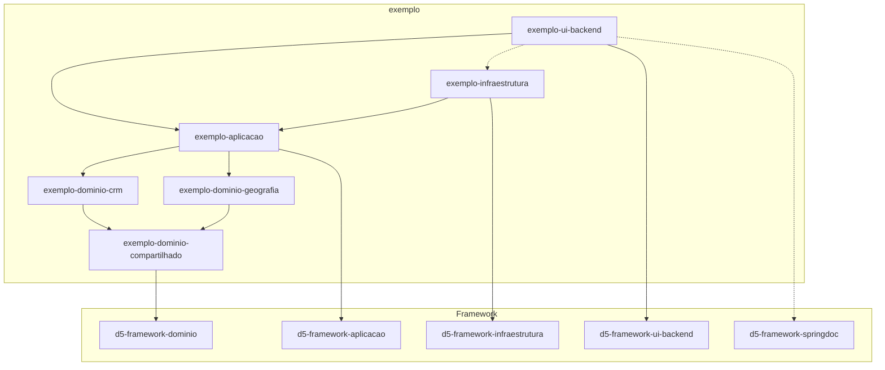

=== "dominio-compartilhado"

    ```xml title="exemplo/dominio-compartilhado/pom.xml"
    --8<-- "exemplo/dominio-compartilhado/pom.xml"
    ```

=== "dominio-geografia"

    ```xml title="exemplo/dominio-geografia/pom.xml"
    --8<-- "exemplo/dominio-geografia/pom.xml"
    ```

=== "dominio-crm"

    ```xml title="exemplo/dominio-crm/pom.xml"
    --8<-- "exemplo/dominio-crm/pom.xml"
    ```

=== "aplicacao"

    ```xml title="exemplo/aplicacao/pom.xml"
    --8<-- "exemplo/aplicacao/pom.xml"
    ```

=== "infraestrutura"

    ```xml title="exemplo/infraestrutura/pom.xml"
    --8<-- "exemplo/infraestrutura/pom.xml"
    ```

=== "ui-backend"

    ```xml title="exemplo/ui-backend/pom.xml"
    --8<-- "exemplo/ui-backend/pom.xml"
    ```

## Subdomínio Geografia

### Unidade federativa
Uma unidade federativa é identificada por um código IBGE. Além disso, possui sigla e nome únicos. A sigla e o código IBGE são [objetos de valor](referencia/framework/dominio.md#iobjetovalor) associados ao [agregado](referencia/framework/dominio.md#iagregado) unidade federativa. Seguindo as [convenções](referencia/convencoes.md#pacotes), o pacote dos três é `com.example.exemplo.dominio.geografia.unidadefederativa`. Crie o `package-info.java` desse pacote, anotado com [`@NullMarked`](referencia/programacao.md#evite-null):

```java title="exemplo/dominio-geografia/src/main/java/com/example/exemplo/dominio/geografia/unidadefederativa/package-info.java"
--8<-- "exemplo/dominio-geografia/src/main/java/com/example/exemplo/dominio/geografia/unidadefederativa/package-info.java"
```

#### Domínio

##### Sigla
A sigla é formada por duas letras maiúsculas e é única para cada unidade federativa. Portanto, seu formato pode ser definido através de uma expressão regular. Objetos de valor desse tipo herdam de [`ObjetoValorRegexAbstrato`](referencia/framework/dominio.md#objetovalorregexabstrato).

```java title="exemplo/dominio-geografia/src/main/java/com/example/exemplo/dominio/geografia/unidadefederativa/UnidadeFederativaSigla.java"
--8<-- "exemplo/dominio-geografia/src/main/java/com/example/exemplo/dominio/geografia/unidadefederativa/UnidadeFederativaSigla.java"
```

##### Código IBGE
O código IBGE é formado por dois dígitos e, portanto, também herda de [`ObjetoValorRegexAbstrato`](referencia/framework/dominio.md#objetovalorregexabstrato). Adicionalmente, como o código IBGE identifica uma unidade federativa, sua classe implementa [`IIdentificador`](referencia/framework/dominio.md#iidentificador).

```java title="exemplo/dominio-geografia/src/main/java/com/example/exemplo/dominio/geografia/unidadefederativa/UnidadeFederativaCodigoIbge.java"
--8<-- "exemplo/dominio-geografia/src/main/java/com/example/exemplo/dominio/geografia/unidadefederativa/UnidadeFederativaCodigoIbge.java"
```

##### Agregado
Unidade federativa, código IBGE e sigla formam um [agregado](referencia/framework/dominio.md#iagregado), com `UnidadeFederativa` como raiz — por isso ela implementa `IAgregado`.

```java title="exemplo/dominio-geografia/src/main/java/com/example/exemplo/dominio/geografia/unidadefederativa/UnidadeFederativa.java"
--8<-- "exemplo/dominio-geografia/src/main/java/com/example/exemplo/dominio/geografia/unidadefederativa/UnidadeFederativa.java"
```

#### Aplicação
A pesquisa de unidades federativas, ao contrário das demais operações, não passa pelas regras do [agregado](referencia/ddd.md#agregado): ela consulta diretamente uma [projeção](referencia/framework/aplicacao.md#projecao) somente leitura, com paginação, ordenação e filtro. Seguindo as [convenções](referencia/convencoes.md#pacotes), as classes ficam no módulo `exemplo-aplicacao`, pacote `com.example.exemplo.aplicacao.geografia.unidadefederativa`. Crie o `package-info.java` desse pacote, anotado com [`@NullMarked`](referencia/programacao.md#evite-null):

```java title="exemplo/aplicacao/src/main/java/com/example/exemplo/aplicacao/geografia/unidadefederativa/package-info.java"
--8<-- "exemplo/aplicacao/src/main/java/com/example/exemplo/aplicacao/geografia/unidadefederativa/package-info.java"
```

##### Projeção
A projeção de unidade federativa contém apenas seu identificador e seu nome — o suficiente para, por exemplo, popular uma lista de seleção. Ela implementa [`IProjecao`](referencia/framework/aplicacao.md#iprojecao), parametrizada pelo agregado que representa.

```java title="exemplo/aplicacao/src/main/java/com/example/exemplo/aplicacao/geografia/unidadefederativa/UnidadeFederativaProjecao.java"
--8<-- "exemplo/aplicacao/src/main/java/com/example/exemplo/aplicacao/geografia/unidadefederativa/UnidadeFederativaProjecao.java"
```

##### Ordenação
As propriedades pelas quais a projeção pode ser ordenada são declaradas em um `enum` que implementa [`IOrdenacao`](referencia/framework/aplicacao.md#iordenacao), parametrizado pela projeção.

```java title="exemplo/aplicacao/src/main/java/com/example/exemplo/aplicacao/geografia/unidadefederativa/UnidadeFederativaOrdenacao.java"
--8<-- "exemplo/aplicacao/src/main/java/com/example/exemplo/aplicacao/geografia/unidadefederativa/UnidadeFederativaOrdenacao.java"
```

##### Consulta
Os parâmetros da pesquisa são representados por uma classe que estende [`Consulta`](referencia/framework/aplicacao.md#consulta-classe), acrescentando o atributo `nome`, usado para filtrar as unidades federativas por um trecho do nome.

```java title="exemplo/aplicacao/src/main/java/com/example/exemplo/aplicacao/geografia/unidadefederativa/UnidadeFederativaConsulta.java"
--8<-- "exemplo/aplicacao/src/main/java/com/example/exemplo/aplicacao/geografia/unidadefederativa/UnidadeFederativaConsulta.java"
```

##### Repositório de aplicação
Assim como o [repositório](#repositorio) do agregado, a pesquisa de projeções é acessada através de um repositório — neste caso, um [repositório de aplicação](referencia/framework/aplicacao.md#repositorio-de-aplicacao). Sua interface fica no pacote `com.example.exemplo.aplicacao.geografia.unidadefederativa.spi` e estende [`IAgregadoAplicacaoRepositorio`](referencia/framework/aplicacao.md#iagregadoaplicacaorepositorio), parametrizada pela projeção e pela consulta de unidade federativa. Crie o `package-info.java` desse pacote, anotado com [`@NullMarked`](referencia/programacao.md#evite-null):

```java title="exemplo/aplicacao/src/main/java/com/example/exemplo/aplicacao/geografia/unidadefederativa/spi/package-info.java"
--8<-- "exemplo/aplicacao/src/main/java/com/example/exemplo/aplicacao/geografia/unidadefederativa/spi/package-info.java"
```

```java title="exemplo/aplicacao/src/main/java/com/example/exemplo/aplicacao/geografia/unidadefederativa/spi/IUnidadeFederativaAplicacaoRepositorio.java"
--8<-- "exemplo/aplicacao/src/main/java/com/example/exemplo/aplicacao/geografia/unidadefederativa/spi/IUnidadeFederativaAplicacaoRepositorio.java"
```

##### Serviço de aplicação
A pesquisa é encapsulada em um serviço de aplicação que estende [`AgregadoAplicacaoServicoAbstrato`](referencia/framework/aplicacao.md#agregadoaplicacaoservicoabstrato). Ele recebe pelo construtor o repositório de aplicação e o [`UnidadeFederativaServico`](#servico), reaproveitado apenas para validar se o usuário está autorizado a buscar unidades federativas.

```java title="exemplo/aplicacao/src/main/java/com/example/exemplo/aplicacao/geografia/unidadefederativa/UnidadeFederativaAplicacaoServico.java"
--8<-- "exemplo/aplicacao/src/main/java/com/example/exemplo/aplicacao/geografia/unidadefederativa/UnidadeFederativaAplicacaoServico.java"
```

#### Infraestrutura

##### Repositório
Serviços acessam unidades federativas persistidas através de um [repositório](referencia/ddd.md#repositorio). Seguindo as [convenções](referencia/convencoes.md#pacotes), a interface do repositório fica no pacote `com.example.exemplo.dominio.geografia.unidadefederativa.spi` e estende [`IAgregadoRepositorio`](referencia/framework/dominio.md#iagregadorepositorio). Adicionalmente, expõe `existePorSigla` e `existePorNome`, que o serviço usa para garantir que a sigla e o nome de uma unidade federativa sejam únicos. Ambos recebem o identificador da própria unidade federativa a ignorar na verificação, para que alterá-la não a faça conflitar consigo mesma. Crie o `package-info.java` desse pacote, anotado com [`@NullMarked`](referencia/programacao.md#evite-null):

```java title="exemplo/dominio-geografia/src/main/java/com/example/exemplo/dominio/geografia/unidadefederativa/spi/package-info.java"
--8<-- "exemplo/dominio-geografia/src/main/java/com/example/exemplo/dominio/geografia/unidadefederativa/spi/package-info.java"
```

```java title="exemplo/dominio-geografia/src/main/java/com/example/exemplo/dominio/geografia/unidadefederativa/spi/IUnidadeFederativaRepositorio.java"
--8<-- "exemplo/dominio-geografia/src/main/java/com/example/exemplo/dominio/geografia/unidadefederativa/spi/IUnidadeFederativaRepositorio.java"
```

##### Autorização
As regras de autorização sobre um agregado usam papéis compartilhados por todos os subdomínios. Seguindo as [convenções](referencia/convencoes.md#pacotes), declare-os em um `enum` no módulo `exemplo-dominio-compartilhado`, pacote `com.example.exemplo.dominio`. Antes, crie o `package-info.java` desse pacote, anotado com [`@NullMarked`](referencia/programacao.md#evite-null):

```java title="exemplo/dominio-compartilhado/src/main/java/com/example/exemplo/dominio/package-info.java"
--8<-- "exemplo/dominio-compartilhado/src/main/java/com/example/exemplo/dominio/package-info.java"
```

```java title="exemplo/dominio-compartilhado/src/main/java/com/example/exemplo/dominio/Autorizacao.java"
--8<-- "exemplo/dominio-compartilhado/src/main/java/com/example/exemplo/dominio/Autorizacao.java"
```

##### Serviço
Operações sobre unidades federativas são encapsuladas em um [serviço](referencia/ddd.md#servico) que estende [`AgregadoServicoAbstrato`](referencia/framework/dominio.md#agregadoservicoabstrato). Ele implementa `criarAutorizacoes` consultando o [`ISegurancaServico`](referencia/framework/dominio.md#isegurancaservico) recebido no construtor para verificar se o usuário possui a [autorização](#autorizacao) `ADMINISTRADOR`, devolvendo um [`AgregadoAutorizacoes`](referencia/framework/dominio.md#agregadoautorizacoes) que libera a busca a qualquer usuário e as demais operações somente a administradores. Também sobrescreve `validarInclusaoAlteracao` para usar `existePorSigla` e `existePorNome`, ignorando o identificador da própria unidade federativa, e impedir que uma inclusão ou alteração deixe duas unidades federativas com a mesma sigla ou o mesmo nome.

Note que o serviço não leva nenhuma anotação do Spring: ele, os repositórios e o serviço de aplicação são [registrados como beans automaticamente](referencia/framework/comportamentos.md#registro-de-beans).

```java title="exemplo/dominio-geografia/src/main/java/com/example/exemplo/dominio/geografia/unidadefederativa/UnidadeFederativaServico.java"
--8<-- "exemplo/dominio-geografia/src/main/java/com/example/exemplo/dominio/geografia/unidadefederativa/UnidadeFederativaServico.java"
```

##### Testes
O comportamento do serviço é especificado com cenários em Gherkin e automatizado com [Cucumber](https://cucumber.io). Crie a suíte que conecta o Cucumber ao JUnit Platform e seleciona os cenários em `src/test/resources`:

```java title="exemplo/dominio-geografia/src/test/java/com/example/exemplo/dominio/geografia/CucumberTests.java"
--8<-- "exemplo/dominio-geografia/src/test/java/com/example/exemplo/dominio/geografia/CucumberTests.java"
```

Escreva os cenários cobrindo inclusão, busca, alteração e exclusão de uma unidade federativa, incluindo as regras de autorização e de unicidade de sigla e nome:

```gherkin title="exemplo/dominio-geografia/src/test/resources/features/unidade-federativa.feature"
--8<-- "exemplo/dominio-geografia/src/test/resources/features/unidade-federativa.feature"
```

Implemente as step definitions que ligam os cenários ao serviço. Como `UnidadeFederativaServico` depende das abstrações `ISegurancaServico` e `IUnidadeFederativaRepositorio`, use o [Mockito](https://site.mockito.org) para dublá-las: a segurança simula a autorização do usuário, e o repositório simula a persistência através de um mapa em memória, preservando as mesmas regras de unicidade que uma implementação real deve respeitar.

```java title="exemplo/dominio-geografia/src/test/java/com/example/exemplo/dominio/geografia/unidadefederativa/UnidadeFederativaStepDefinitions.java"
--8<-- "exemplo/dominio-geografia/src/test/java/com/example/exemplo/dominio/geografia/unidadefederativa/UnidadeFederativaStepDefinitions.java"
```

##### Entidade JPA
A persistência de unidade federativa é implementada no módulo `exemplo-infraestrutura`, no pacote `com.example.exemplo.infraestrutura.geografia.unidadefederativa`. Crie o `package-info.java` desse pacote, anotado com [`@NullMarked`](referencia/programacao.md#evite-null):

```java title="exemplo/infraestrutura/src/main/java/com/example/exemplo/infraestrutura/geografia/unidadefederativa/package-info.java"
--8<-- "exemplo/infraestrutura/src/main/java/com/example/exemplo/infraestrutura/geografia/unidadefederativa/package-info.java"
```

O primeiro passo é a entidade JPA, que mapeia o agregado para a tabela `UFI_UNIDADE_FEDERATIVA`. Ela implementa [`IAgregadoJpa`](referencia/framework/infraestrutura.md#iagregadojpa), parametrizada pelo agregado que representa, e declara as colunas com o tamanho dos objetos de valor correspondentes.

```java title="exemplo/infraestrutura/src/main/java/com/example/exemplo/infraestrutura/geografia/unidadefederativa/UnidadeFederativaJpa.java"
--8<-- "exemplo/infraestrutura/src/main/java/com/example/exemplo/infraestrutura/geografia/unidadefederativa/UnidadeFederativaJpa.java"
```

##### Repositório Spring Data
Em seguida, crie a interface [Spring Data JPA](https://spring.io/projects/spring-data-jpa){target="_blank"} que dá acesso à entidade. Além de estender `JpaRepository`, ela declara `existePorSigla` e `existePorNome` com consultas JPQL escritas explicitamente, já que essas verificações — que ignoram opcionalmente o identificador da própria unidade federativa — não são derivadas automaticamente do nome do método. Ela também declara `pesquisar`, cuja consulta JPQL instancia a [`UnidadeFederativaProjecao`](#projecao) diretamente através de uma expressão `select new`, filtrando pelo nome apenas quando o parâmetro não é nulo. O filtro é case insensitive porque compara o nome em minúsculas com o padrão produzido por `paraLike`, já em minúsculas, declarando `\` como caractere de escape.

```java title="exemplo/infraestrutura/src/main/java/com/example/exemplo/infraestrutura/geografia/unidadefederativa/IUnidadeFederativaRepositorioJpa.java"
--8<-- "exemplo/infraestrutura/src/main/java/com/example/exemplo/infraestrutura/geografia/unidadefederativa/IUnidadeFederativaRepositorioJpa.java"
```

##### Implementação do repositório
Por fim, implemente [`IUnidadeFederativaRepositorio`](#repositorio) estendendo [`AgregadoRepositorioAbstrato`](referencia/framework/infraestrutura.md#agregadorepositorioabstrato), que já implementa `incluir`, `buscarPorIdentificador`, `alterar`, `excluir` e `existePorIdentificador` a partir dos métodos `paraJpa`, `paraAgregado` e `paraIdentificadorJpa` — os únicos que restam implementar. `existePorSigla` e `existePorNome` delegam para a interface Spring Data, convertendo o identificador a ignorar para o tipo usado pela entidade JPA.

```java title="exemplo/infraestrutura/src/main/java/com/example/exemplo/infraestrutura/geografia/unidadefederativa/UnidadeFederativaRepositorio.java"
--8<-- "exemplo/infraestrutura/src/main/java/com/example/exemplo/infraestrutura/geografia/unidadefederativa/UnidadeFederativaRepositorio.java"
```

##### Implementação do repositório de aplicação
Implemente também [`IUnidadeFederativaAplicacaoRepositorio`](#repositorio-de-aplicacao) estendendo [`AgregadoAplicacaoRepositorioAbstrato`](referencia/framework/infraestrutura.md#agregadoaplicacaorepositorioabstrato). Ela já implementa `pesquisar(UnidadeFederativaConsulta)`, convertendo a consulta em paginação e ordenação do Spring Data — através de `paraPropriedadeOrdenacao`, que mapeia cada valor de [`UnidadeFederativaOrdenacao`](#ordenacao) para a propriedade correspondente — e delegando a `pesquisar(UnidadeFederativaConsulta, Pageable)`, que resta implementar: ele converte o `nome` da consulta em um padrão `like` com [`paraLike`](referencia/framework/infraestrutura.md#agregadoaplicacaorepositorioabstrato) — em minúsculas, escapado e envolvido por `%`, ou `null` na ausência de filtro — e delega à interface Spring Data.

```java title="exemplo/infraestrutura/src/main/java/com/example/exemplo/infraestrutura/geografia/unidadefederativa/UnidadeFederativaAplicacaoRepositorio.java"
--8<-- "exemplo/infraestrutura/src/main/java/com/example/exemplo/infraestrutura/geografia/unidadefederativa/UnidadeFederativaAplicacaoRepositorio.java"
```

##### Testes do repositório
Diferente do serviço, cujo comportamento é especificado com cenários em Gherkin sobre dublês, os repositórios são testados por integração contra um banco H2 embarcado, usando `@DataJpaTest`. Esse tipo de teste exige uma classe de configuração do Spring Boot no classpath de teste — crie uma mínima, anotada com `@SpringBootApplication`:

```java title="exemplo/infraestrutura/src/test/java/com/example/exemplo/infraestrutura/InfraestruturaTesteAplicacao.java"
--8<-- "exemplo/infraestrutura/src/test/java/com/example/exemplo/infraestrutura/InfraestruturaTesteAplicacao.java"
```

Escreva os testes cobrindo as operações do repositório e as duas variações de `existePorSigla` e `existePorNome`: considerando todas as unidades federativas e ignorando o identificador de uma delas.

```java title="exemplo/infraestrutura/src/test/java/com/example/exemplo/infraestrutura/geografia/unidadefederativa/UnidadeFederativaRepositorioTest.java"
--8<-- "exemplo/infraestrutura/src/test/java/com/example/exemplo/infraestrutura/geografia/unidadefederativa/UnidadeFederativaRepositorioTest.java"
```

Escreva também os testes do repositório de aplicação, cobrindo a pesquisa sem filtro, sem resultados e filtrando por um trecho do nome.

```java title="exemplo/infraestrutura/src/test/java/com/example/exemplo/infraestrutura/geografia/unidadefederativa/UnidadeFederativaAplicacaoRepositorioTest.java"
--8<-- "exemplo/infraestrutura/src/test/java/com/example/exemplo/infraestrutura/geografia/unidadefederativa/UnidadeFederativaAplicacaoRepositorioTest.java"
```

#### UI
Unidade federativa é exposta como uma API REST no módulo `exemplo-ui-backend`, pacote `com.example.exemplo.ui.backend.geografia.unidadefederativa`. Crie o `package-info.java` desse pacote, anotado com [`@NullMarked`](referencia/programacao.md#evite-null):

```java title="exemplo/ui-backend/src/main/java/com/example/exemplo/ui/backend/geografia/unidadefederativa/package-info.java"
--8<-- "exemplo/ui-backend/src/main/java/com/example/exemplo/ui/backend/geografia/unidadefederativa/package-info.java"
```

##### Controlador
O controlador estende [`AgregadoControladorAbstrato`](referencia/framework/ui-backend.md#agregadocontroladorabstrato), parametrizado pelo identificador, agregado, autorizações, projeção e consulta de unidade federativa, e recebe pelo construtor o [`UnidadeFederativaServico`](#servico) e o [`UnidadeFederativaAplicacaoServico`](#servico-de-aplicacao). O `@RequestMapping` combina o prefixo [`Backend.PREFIXO`](referencia/framework/ui-backend.md#backend) com o caminho `geografia/unidade-federativa`. O parâmetro `identificador` dos endpoints é recebido diretamente como `UnidadeFederativaCodigoIbge` graças à [serialização de objetos de valor](referencia/framework/comportamentos.md#serializacao-de-objetos-de-valor), e as operações de escrita são executadas em uma transação graças ao [gerenciamento de transações](referencia/framework/comportamentos.md#gerenciamento-de-transacoes).

```java title="exemplo/ui-backend/src/main/java/com/example/exemplo/ui/backend/geografia/unidadefederativa/UnidadeFederativaControlador.java"
--8<-- "exemplo/ui-backend/src/main/java/com/example/exemplo/ui/backend/geografia/unidadefederativa/UnidadeFederativaControlador.java"
```

##### Segurança
Restrinja o backend a usuários autenticados criando uma configuração de segurança, no pacote `com.example.exemplo.ui.backend.seguranca`, que estende [`SegurancaConfiguracaoAbstrata`](referencia/framework/ui-backend.md#segurancaconfiguracaoabstrata): ela já protege `/backend/**` com autenticação HTTP Basic e CSRF baseado em cookie, restando declarar, em `autorizar`, quais endpoints liberar — sem nenhuma regra, todo endpoint sob `/backend/**` seria negado; aqui, todos passam a exigir apenas autenticação — e expor os usuários disponíveis através de um `UserDetailsService`. Este exemplo declara dois usuários em memória: `a`/`a`, com a [autorização](#autorizacao) `ADMINISTRADOR`, e `u`/`u`, com `USUARIO`. Crie o `package-info.java` desse pacote, anotado com [`@NullMarked`](referencia/programacao.md#evite-null):

```java title="exemplo/ui-backend/src/main/java/com/example/exemplo/ui/backend/seguranca/package-info.java"
--8<-- "exemplo/ui-backend/src/main/java/com/example/exemplo/ui/backend/seguranca/package-info.java"
```

```java title="exemplo/ui-backend/src/main/java/com/example/exemplo/ui/backend/seguranca/SegurancaConfiguracao.java"
--8<-- "exemplo/ui-backend/src/main/java/com/example/exemplo/ui/backend/seguranca/SegurancaConfiguracao.java"
```

##### Autenticação
Para o cliente descobrir o usuário autenticado, crie um controlador que estende [`AutenticacaoControladorAbstrato`](referencia/framework/ui-backend.md#autenticacaocontroladorabstrato), expondo esse recurso em `Backend.PREFIXO + "autenticacao"`.

```java title="exemplo/ui-backend/src/main/java/com/example/exemplo/ui/backend/seguranca/AutenticacaoControlador.java"
--8<-- "exemplo/ui-backend/src/main/java/com/example/exemplo/ui/backend/seguranca/AutenticacaoControlador.java"
```

##### Aplicação Spring Boot
Por fim, crie a classe com o `main` que sobe a aplicação, anotada com `@SpringBootApplication`, no pacote raiz `com.example.exemplo`. É a partir do pacote dela que o component scan encontra os controladores e a configuração de segurança, e que o [registro de beans](referencia/framework/comportamentos.md#registro-de-beans) encontra os serviços e as implementações de repositório de todos os subdomínios. Crie o `package-info.java` desse pacote, anotado com [`@NullMarked`](referencia/programacao.md#evite-null):

```java title="exemplo/ui-backend/src/main/java/com/example/exemplo/package-info.java"
--8<-- "exemplo/ui-backend/src/main/java/com/example/exemplo/package-info.java"
```

```java title="exemplo/ui-backend/src/main/java/com/example/exemplo/BackendAplicacao.java"
--8<-- "exemplo/ui-backend/src/main/java/com/example/exemplo/BackendAplicacao.java"
```

##### Testando com o Swagger UI
Suba `BackendAplicacao` — pela IDE ou executando `mvn spring-boot:run` no módulo `exemplo/ui-backend` — e acesse `http://localhost:8080/swagger-ui/index.html`. Como `d5-framework-springdoc` está no classpath, o Swagger UI é gerado automaticamente a partir dos controladores do backend, listados sob a tag `unidade-federativa-controlador`:

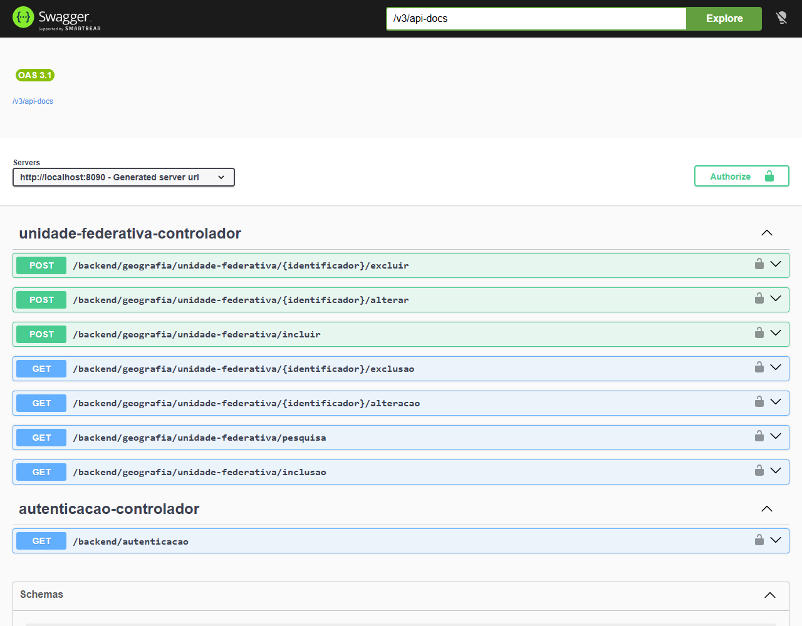

Como todo endpoint sob `/backend/**` exige um usuário autenticado, e a aplicação não desafia o navegador com o diálogo nativo de autenticação básica, é preciso autenticar pelo próprio Swagger UI: clique em **Authorize**, no canto superior direito, e informe um dos usuários criados na [configuração de segurança](#seguranca) — `a`/`a`, administrador, ou `u`/`u`, usuário comum.

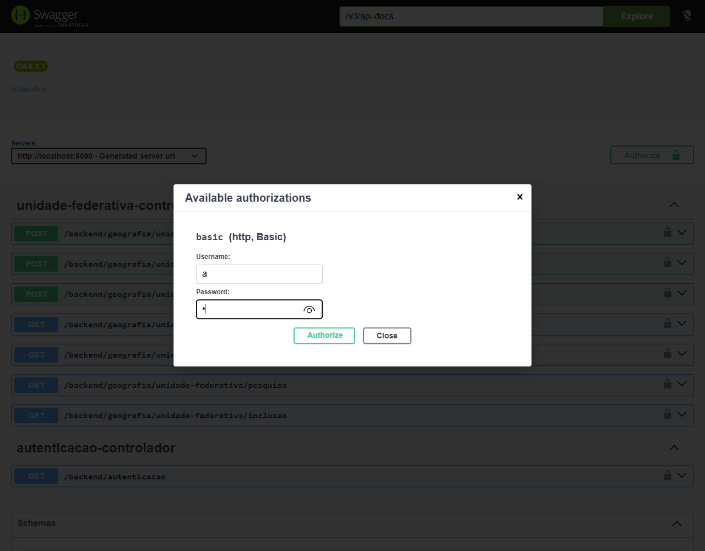

A partir daí, toda requisição disparada pelo Swagger UI leva o cabeçalho `Authorization` com essas credenciais. O primeiro `Execute`, ainda que sem sucesso, também recebe do servidor o cookie `XSRF-TOKEN`, exigido pelas operações de escrita — como o Swagger UI só lê esse cookie ao carregar a página (veja [CSRF no Swagger UI](referencia/framework/comportamentos.md#csrf-no-swagger-ui)), recarregue a página e autentique-se novamente antes de tentar incluir, alterar ou excluir. Sem o cookie, as operações de escrita respondem 401, ainda que as credenciais sejam válidas.

Com a sessão autenticada, expanda cada operação e use **Try it out**:

###### Incluir
`GET /backend/geografia/unidade-federativa/inclusao` não recebe parâmetros e devolve um recurso vazio, usado apenas para montar o formulário de inclusão. `POST /backend/geografia/unidade-federativa/incluir` recebe a unidade federativa no corpo:

```json
{
  "identificador": "35",
  "sigla": "SP",
  "nome": "São Paulo"
}
```

O código IBGE e a sigla trafegam como strings simples graças à [serialização de objetos de valor](referencia/framework/comportamentos.md#serializacao-de-objetos-de-valor).

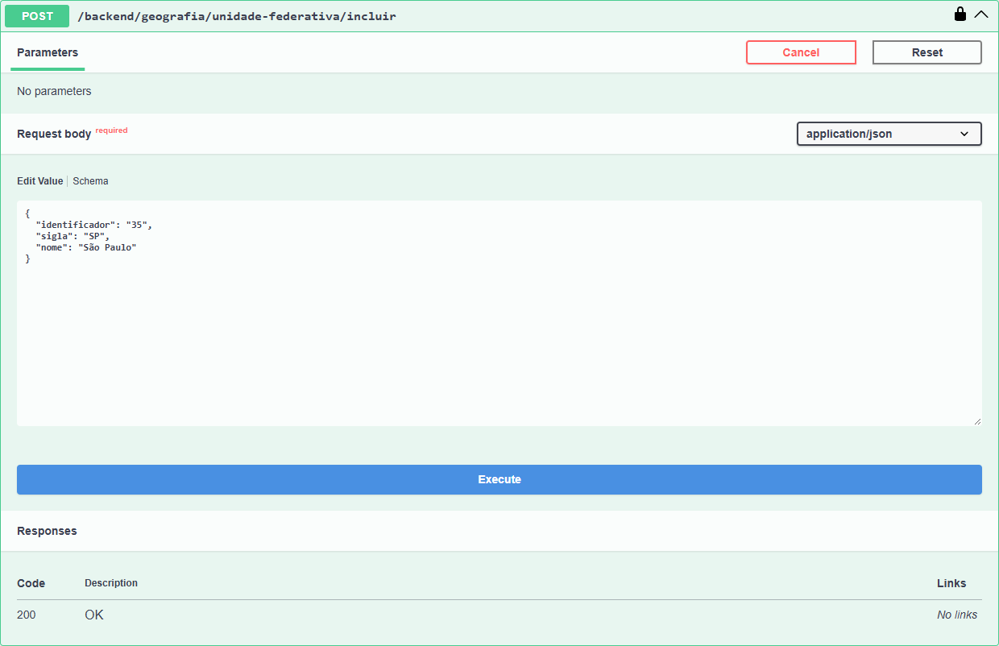

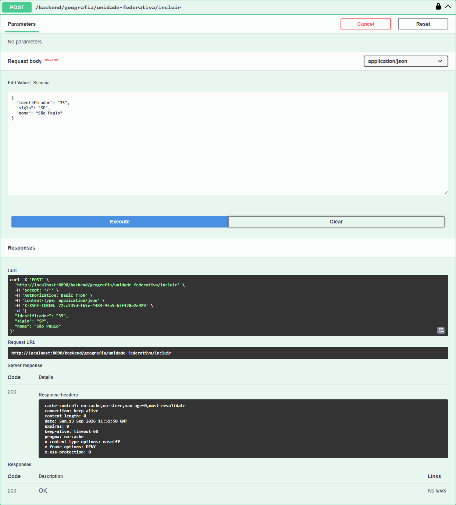

###### Pesquisar
`GET /backend/geografia/unidade-federativa/pesquisa` recebe os campos de [`UnidadeFederativaConsulta`](#consulta) — `nome` (filtro parcial, opcional), `ordenacao`, `descendente`, `indicePagina` e `tamanhoPagina` — como parâmetros de consulta individuais, e o Swagger UI, graças à [expansão da consulta](referencia/framework/comportamentos.md#expansao-da-consulta-no-swagger-ui) feita pelo `d5-framework-springdoc`, exibe cada um como um campo separado do formulário. Deixe em branco os campos que não quiser informar — eles assumem os padrões declarados em [`Consulta`](referencia/framework/aplicacao.md#consulta-classe); deixe todos em branco para listar a primeira página, sem filtro. Valores inválidos, como `tamanhoPagina` igual a `0`, resultam em 422, com a mensagem da validação; veja [`ExcecaoManipulador`](referencia/framework/ui-backend.md#excecaomanipulador).

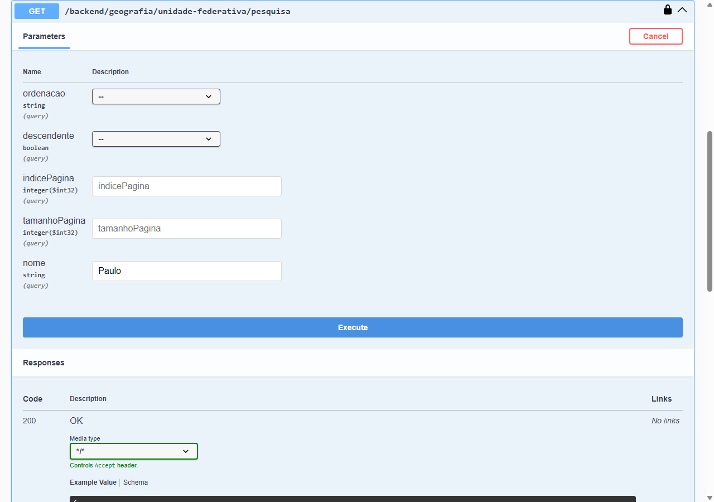

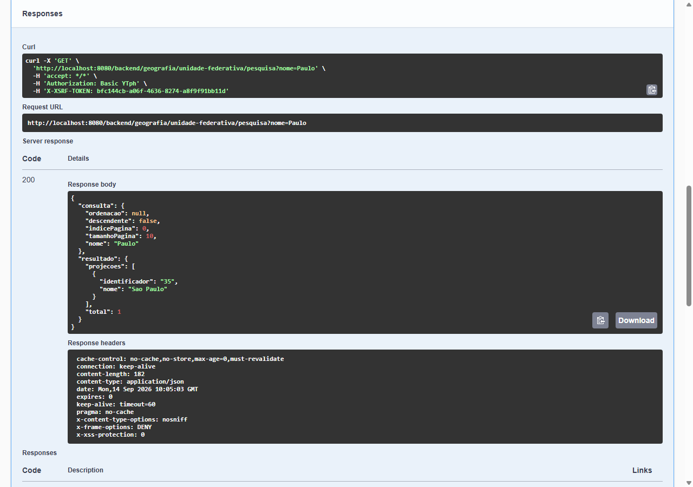

###### Alterar
`GET /backend/geografia/unidade-federativa/{identificador}/alteracao` recebe o código IBGE no parâmetro de caminho `identificador` — por exemplo, `35` — e devolve o agregado e as autorizações do usuário atual sobre ele:

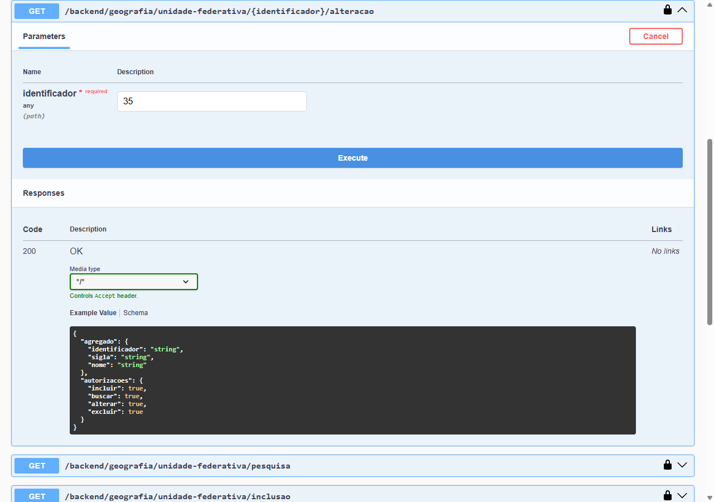

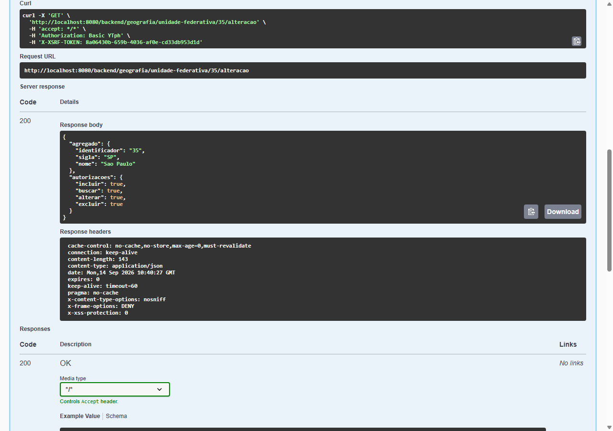

`POST /backend/geografia/unidade-federativa/{identificador}/alterar` recebe o mesmo `identificador` no caminho e a unidade federativa alterada no corpo, repetindo o identificador:

```json
{
  "identificador": "35",
  "sigla": "SP",
  "nome": "São Paulo (alterado)"
}
```

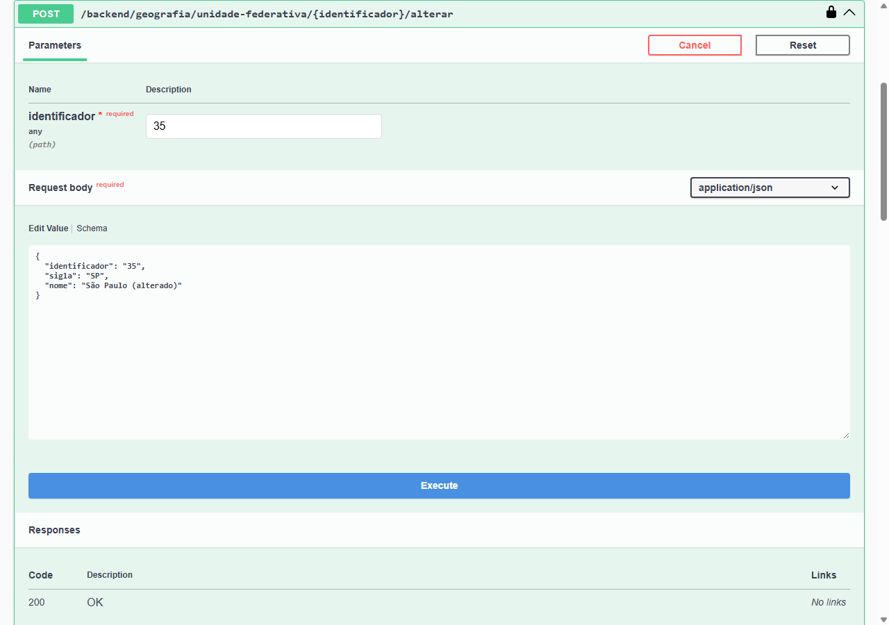

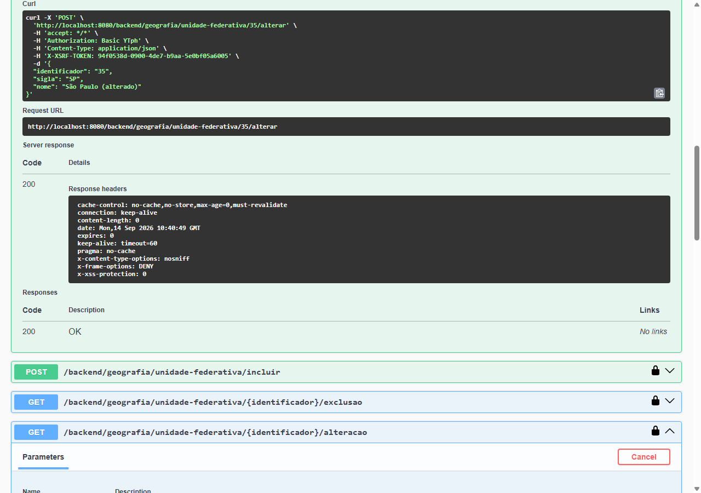

###### Excluir
`GET /backend/geografia/unidade-federativa/{identificador}/exclusao` recebe o mesmo parâmetro `identificador` e devolve novamente o agregado e as autorizações, desta vez para confirmar a exclusão:

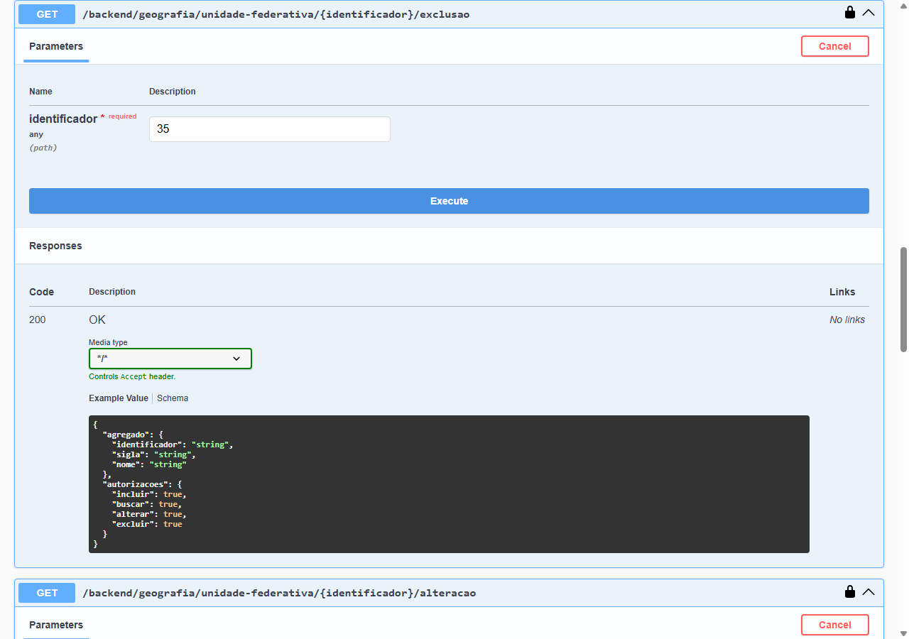


`POST /backend/geografia/unidade-federativa/{identificador}/excluir` recebe apenas o `identificador` no caminho, sem corpo:

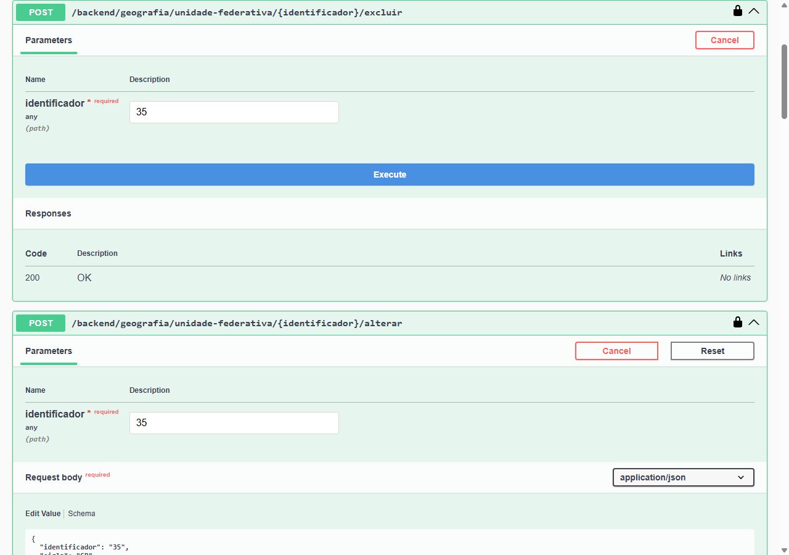

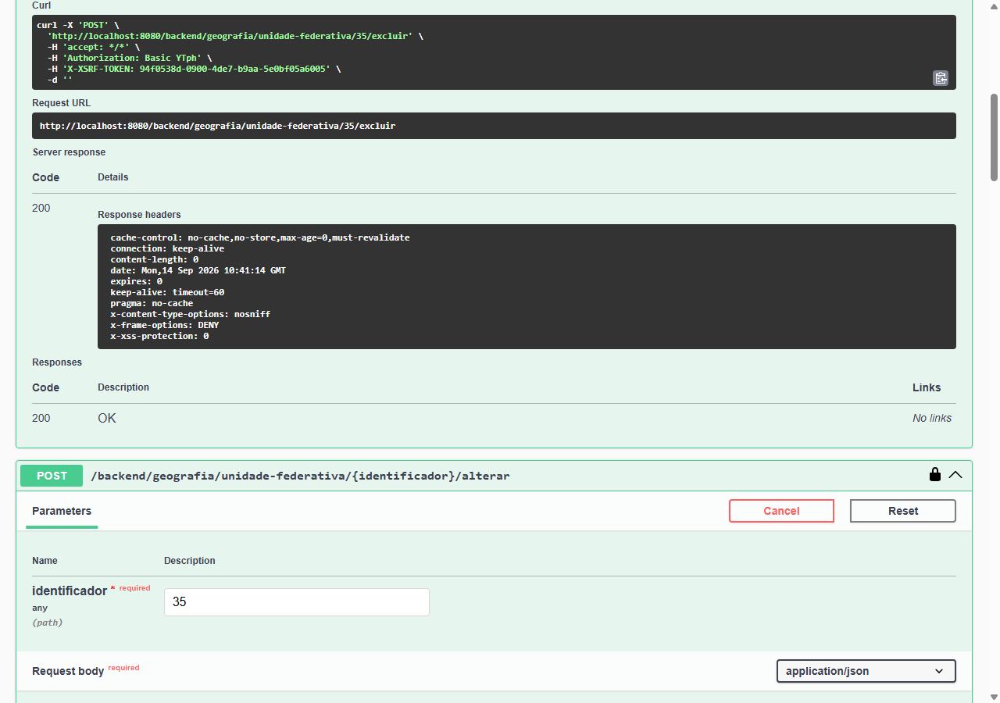

Como o usuário `u` não é administrador, repetir as operações de escrita autenticado como `u` deve falhar de acordo com as autorizações definidas em [`UnidadeFederativaServico`](#servico) — a pesquisa e os formulários de alteração e de exclusão, que dependem apenas da autorização de busca, são permitidos a qualquer usuário autenticado, mas as operações de escrita respondem 403.