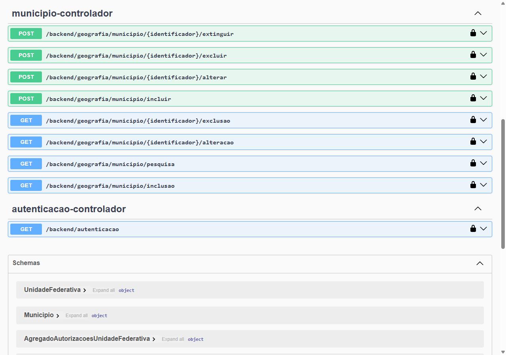
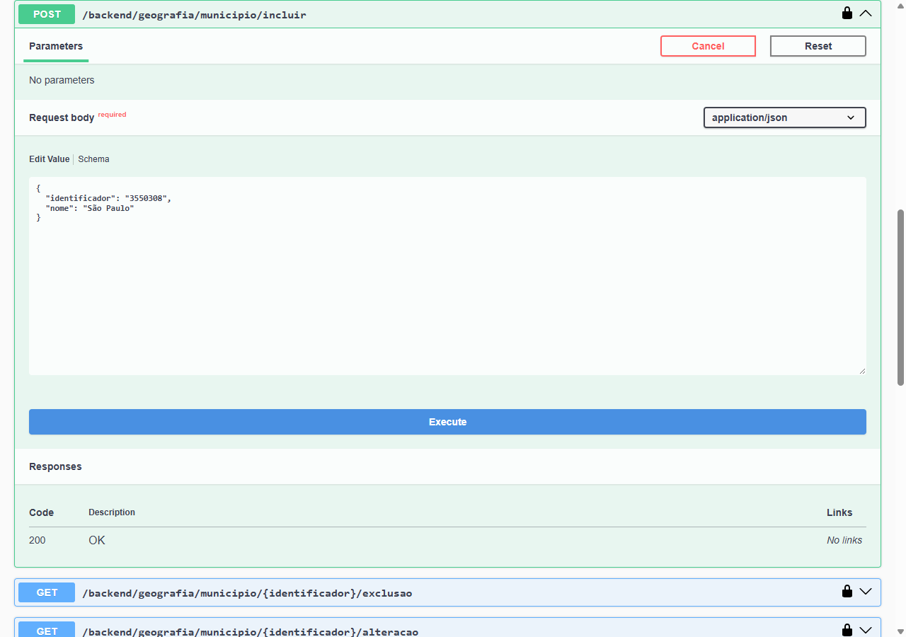
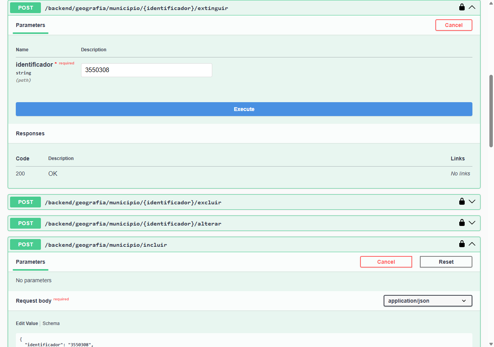
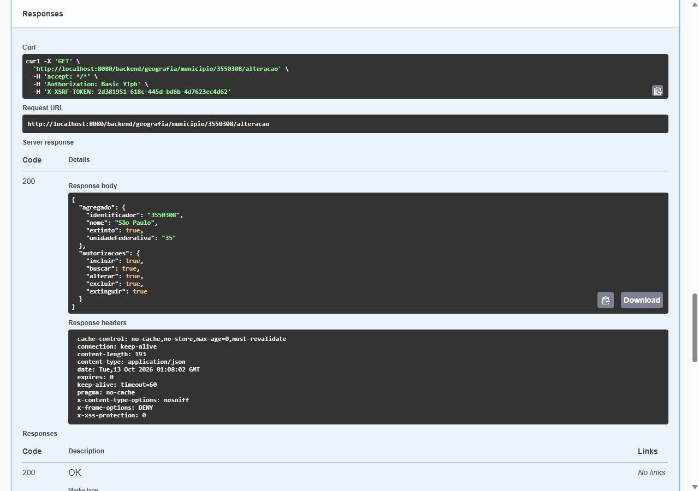
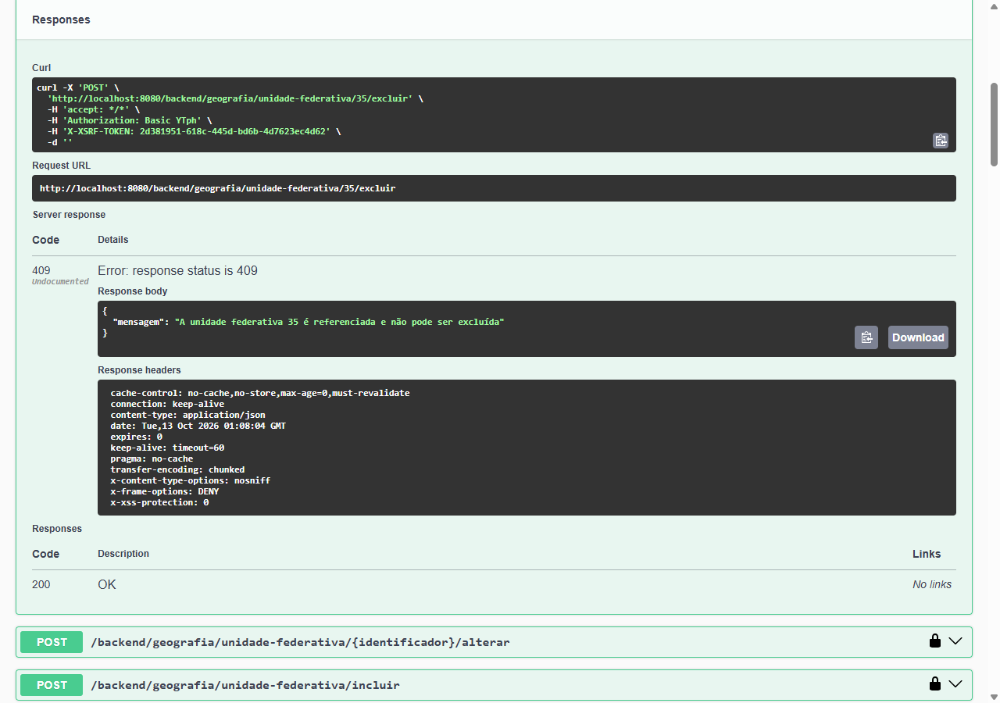

# Lição 2: município
Nesta lição, você vai acrescentar ao subdomínio Geografia o agregado município, que referencia a unidade federativa criada na [lição 1](1-unidade-federativa.md). Ao final, o projeto corresponde ao diretório `exemplo2` do repositório de D5.

O município segue a mesma estrutura da unidade federativa — objetos de valor, agregado, repositório, serviço, projeção, consulta, ordenação, entidade JPA e controlador —, por isso esta lição explica apenas o que muda:

- o identificador do município contém o identificador da unidade federativa;
- o município referencia a unidade federativa pelo identificador, e não por um objeto;
- o serviço valida a existência de outro agregado e oferece uma ação além das quatro operações básicas: extinguir;
- a projeção traz o nome da unidade federativa, obtido por junção na consulta JPQL;
- a unidade federativa passa a ser referenciada e, por isso, não pode mais ser excluída enquanto houver municípios nela.

## Município
Um município é identificado por um código IBGE de sete dígitos e possui um nome único na unidade federativa a que pertence. Um município pode ser extinto, o que o mantém cadastrado, mas impede que seja alterado. Seguindo as [convenções](../referencia/convencoes.md#pacotes), o pacote do agregado é `com.example.exemplo.dominio.geografia.municipio`. Crie o `package-info.java` desse pacote, anotado com [`@NullMarked`](../referencia/programacao.md#evite-null):

```java title="exemplo/dominio-geografia/src/main/java/com/example/exemplo/dominio/geografia/municipio/package-info.java"
--8<-- "exemplo2/dominio-geografia/src/main/java/com/example/exemplo/dominio/geografia/municipio/package-info.java"
```

### Domínio

#### Código IBGE
Os dois primeiros dígitos do código IBGE de um município são o código IBGE da unidade federativa a que ele pertence. Por isso, além de validar o formato com [`ObjetoValorRegexAbstrato`](../referencia/framework/dominio.md#objetovalorregexabstrato) e identificar o município com [`IIdentificador`](../referencia/framework/dominio.md#iidentificador), o objeto de valor expõe `getUnidadeFederativa`, que deriva o [código IBGE da unidade federativa](1-unidade-federativa.md#codigo-ibge) desses dois dígitos.

```java title="exemplo/dominio-geografia/src/main/java/com/example/exemplo/dominio/geografia/municipio/MunicipioCodigoIbge.java"
--8<-- "exemplo2/dominio-geografia/src/main/java/com/example/exemplo/dominio/geografia/municipio/MunicipioCodigoIbge.java"
```

#### Agregado
O município referencia a unidade federativa apenas pelo seu identificador, derivado do código IBGE, e não por um objeto `UnidadeFederativa`: cada [agregado](../referencia/ddd.md#agregado) é carregado, validado e persistido isoladamente, e um agregado só conhece os demais pelos seus identificadores.

O indicador de extinção é recebido no construtor como `Optional<Boolean>` — um município incluído sem esse indicador não está extinto. Um município só se torna extinto através de `extinguir`, que devolve um novo município, em vez de alterar o atual, e, [validando o estado](../referencia/programacao.md#validacao-de-estado) do município, rejeita a extinção de um município já extinto.

```java title="exemplo/dominio-geografia/src/main/java/com/example/exemplo/dominio/geografia/municipio/Municipio.java"
--8<-- "exemplo2/dominio-geografia/src/main/java/com/example/exemplo/dominio/geografia/municipio/Municipio.java"
```

#### Repositório
O nome de um município é único apenas na unidade federativa a que ele pertence. Por isso, `existePorNome` recebe, além do nome e do identificador a ignorar, a unidade federativa em que a verificação é feita. Crie o pacote `spi` e seu `package-info.java`, anotado com [`@NullMarked`](../referencia/programacao.md#evite-null):

```java title="exemplo/dominio-geografia/src/main/java/com/example/exemplo/dominio/geografia/municipio/spi/package-info.java"
--8<-- "exemplo2/dominio-geografia/src/main/java/com/example/exemplo/dominio/geografia/municipio/spi/package-info.java"
```

```java title="exemplo/dominio-geografia/src/main/java/com/example/exemplo/dominio/geografia/municipio/spi/IMunicipioRepositorio.java"
--8<-- "exemplo2/dominio-geografia/src/main/java/com/example/exemplo/dominio/geografia/municipio/spi/IMunicipioRepositorio.java"
```

#### Autorizações
[`AgregadoAutorizacoes`](../referencia/framework/dominio.md#agregadoautorizacoes) representa apenas as quatro operações básicas. Como o município oferece também a ação de extinguir, suas autorizações estendem essa classe, acrescentando a autorização `extinguir`.

```java title="exemplo/dominio-geografia/src/main/java/com/example/exemplo/dominio/geografia/municipio/MunicipioAutorizacoes.java"
--8<-- "exemplo2/dominio-geografia/src/main/java/com/example/exemplo/dominio/geografia/municipio/MunicipioAutorizacoes.java"
```

#### Serviço
Como na unidade federativa, o serviço estende [`AgregadoServicoAbstrato`](../referencia/framework/dominio.md#agregadoservicoabstrato), agora parametrizado por `MunicipioAutorizacoes`, e libera a busca a qualquer usuário e as demais operações — inclusive extinguir — somente a administradores. Além de `IMunicipioRepositorio`, ele recebe [`IUnidadeFederativaRepositorio`](1-unidade-federativa.md#repositorio), para verificar a existência da unidade federativa do município. Em `validarInclusaoAlteracao`, o serviço:

- [valida o argumento](../referencia/programacao.md#validacao-de-argumentos), rejeitando um município já extinto, que só pode se tornar extinto pela ação de extinguir;
- usa `validarExistencia`, com o modelo de mensagem de [`UnidadeFederativaServico`](1-unidade-federativa.md#servico), para exigir que a unidade federativa exista;
- usa `validarInexistencia` e `existePorNome` para exigir que o nome seja único na unidade federativa.

Em `validarAlteracao`, ponto de extensão exclusivo da alteração, o serviço rejeita a alteração de um município extinto. Por fim, `extinguir` valida a autorização `extinguir` com `validarAutorizacao` e a existência do município com `validarExistencia` — ambos herdados de `AgregadoServicoAbstrato` — e persiste o município devolvido por `Municipio.extinguir`.

```java title="exemplo/dominio-geografia/src/main/java/com/example/exemplo/dominio/geografia/municipio/MunicipioServico.java"
--8<-- "exemplo2/dominio-geografia/src/main/java/com/example/exemplo/dominio/geografia/municipio/MunicipioServico.java"
```

#### Testes
Escreva os cenários cobrindo, além da inclusão, da busca, da alteração e da exclusão, a ação de extinguir e as regras de existência da unidade federativa, de unicidade do nome na unidade federativa e de imutabilidade de um município extinto:

```gherkin title="exemplo/dominio-geografia/src/test/resources/features/municipio.feature"
--8<-- "exemplo2/dominio-geografia/src/test/resources/features/municipio.feature"
```

As step definitions dublam, além da segurança e do repositório de municípios, o repositório de unidades federativas, que simula a existência das unidades federativas através de um conjunto de identificadores. A suíte do Cucumber do subdomínio, criada na lição 1, já seleciona os novos cenários.

```java title="exemplo/dominio-geografia/src/test/java/com/example/exemplo/dominio/geografia/municipio/MunicipioStepDefinitions.java"
--8<-- "exemplo2/dominio-geografia/src/test/java/com/example/exemplo/dominio/geografia/municipio/MunicipioStepDefinitions.java"
```

### Unidade federativa referenciada
Agora que municípios referenciam unidades federativas, excluir uma unidade federativa com municípios deixaria esses municípios órfãos. Para impedir isso, o repositório de unidade federativa passa a expor `existeReferencia`, que informa se algum outro agregado referencia a unidade federativa. Quais agregados são esses é um detalhe da implementação do repositório: o serviço de unidade federativa não precisa conhecer o município, e continuará sem conhecer outros agregados que venham a referenciá-la.

Acrescente `existeReferencia` à interface do repositório:

```java title="exemplo/dominio-geografia/src/main/java/com/example/exemplo/dominio/geografia/unidadefederativa/spi/IUnidadeFederativaRepositorio.java"
--8<-- "exemplo2/dominio-geografia/src/main/java/com/example/exemplo/dominio/geografia/unidadefederativa/spi/IUnidadeFederativaRepositorio.java"
```

Em `UnidadeFederativaServico`, sobrescreva `validarExclusao` para usar `existeReferencia` e, [validando o estado](../referencia/programacao.md#validacao-de-estado) da aplicação, impedir a exclusão de uma unidade federativa referenciada:

```java title="exemplo/dominio-geografia/src/main/java/com/example/exemplo/dominio/geografia/unidadefederativa/UnidadeFederativaServico.java"
--8<-- "exemplo2/dominio-geografia/src/main/java/com/example/exemplo/dominio/geografia/unidadefederativa/UnidadeFederativaServico.java"
```

Acrescente aos cenários da unidade federativa a exclusão de uma unidade federativa referenciada e, às step definitions, a simulação das unidades federativas referenciadas, através de um conjunto de identificadores:

```gherkin title="exemplo/dominio-geografia/src/test/resources/features/unidade-federativa.feature"
--8<-- "exemplo2/dominio-geografia/src/test/resources/features/unidade-federativa.feature"
```

```java title="exemplo/dominio-geografia/src/test/java/com/example/exemplo/dominio/geografia/unidadefederativa/UnidadeFederativaStepDefinitions.java"
--8<-- "exemplo2/dominio-geografia/src/test/java/com/example/exemplo/dominio/geografia/unidadefederativa/UnidadeFederativaStepDefinitions.java"
```

### Aplicação
As classes de aplicação do município ficam no pacote `com.example.exemplo.aplicacao.geografia.municipio`. Crie o `package-info.java` desse pacote, anotado com [`@NullMarked`](../referencia/programacao.md#evite-null):

```java title="exemplo/aplicacao/src/main/java/com/example/exemplo/aplicacao/geografia/municipio/package-info.java"
--8<-- "exemplo2/aplicacao/src/main/java/com/example/exemplo/aplicacao/geografia/municipio/package-info.java"
```

#### Projeção
Uma lista de municípios costuma exibir o nome da unidade federativa de cada um, e não apenas seu código. Por isso, a projeção traz, além do identificador, do nome, do indicador de extinção e do código da unidade federativa, o nome da unidade federativa — que não pertence ao agregado município, mas é obtido pela consulta que instancia a projeção.

```java title="exemplo/aplicacao/src/main/java/com/example/exemplo/aplicacao/geografia/municipio/MunicipioProjecao.java"
--8<-- "exemplo2/aplicacao/src/main/java/com/example/exemplo/aplicacao/geografia/municipio/MunicipioProjecao.java"
```

#### Ordenação
Além do identificador e do nome, os municípios podem ser ordenados pelo nome da unidade federativa.

```java title="exemplo/aplicacao/src/main/java/com/example/exemplo/aplicacao/geografia/municipio/MunicipioOrdenacao.java"
--8<-- "exemplo2/aplicacao/src/main/java/com/example/exemplo/aplicacao/geografia/municipio/MunicipioOrdenacao.java"
```

#### Consulta
A consulta filtra os municípios por um trecho do nome e pelo código da unidade federativa.

```java title="exemplo/aplicacao/src/main/java/com/example/exemplo/aplicacao/geografia/municipio/MunicipioConsulta.java"
--8<-- "exemplo2/aplicacao/src/main/java/com/example/exemplo/aplicacao/geografia/municipio/MunicipioConsulta.java"
```

#### Repositório de aplicação e serviço de aplicação
Como na unidade federativa, crie a interface do repositório de aplicação no pacote `spi` e o serviço de aplicação, parametrizado agora por `MunicipioAutorizacoes`:

```java title="exemplo/aplicacao/src/main/java/com/example/exemplo/aplicacao/geografia/municipio/spi/package-info.java"
--8<-- "exemplo2/aplicacao/src/main/java/com/example/exemplo/aplicacao/geografia/municipio/spi/package-info.java"
```

```java title="exemplo/aplicacao/src/main/java/com/example/exemplo/aplicacao/geografia/municipio/spi/IMunicipioAplicacaoRepositorio.java"
--8<-- "exemplo2/aplicacao/src/main/java/com/example/exemplo/aplicacao/geografia/municipio/spi/IMunicipioAplicacaoRepositorio.java"
```

```java title="exemplo/aplicacao/src/main/java/com/example/exemplo/aplicacao/geografia/municipio/MunicipioAplicacaoServico.java"
--8<-- "exemplo2/aplicacao/src/main/java/com/example/exemplo/aplicacao/geografia/municipio/MunicipioAplicacaoServico.java"
```

### Infraestrutura
A persistência de município fica no pacote `com.example.exemplo.infraestrutura.geografia.municipio`. Crie o `package-info.java` desse pacote, anotado com [`@NullMarked`](../referencia/programacao.md#evite-null):

```java title="exemplo/infraestrutura/src/main/java/com/example/exemplo/infraestrutura/geografia/municipio/package-info.java"
--8<-- "exemplo2/infraestrutura/src/main/java/com/example/exemplo/infraestrutura/geografia/municipio/package-info.java"
```

#### Entidade JPA
Assim como no agregado, a entidade JPA do município guarda apenas o código da unidade federativa, em uma coluna simples, e não uma associação `@ManyToOne` com `UnidadeFederativaJpa`: as entidades JPA de agregados diferentes permanecem independentes. A coluna da unidade federativa, derivada do identificador, também não pode ser alterada. A restrição de unicidade sobre a unidade federativa e o nome garante no banco de dados a mesma unicidade validada pelo serviço.

```java title="exemplo/infraestrutura/src/main/java/com/example/exemplo/infraestrutura/geografia/municipio/MunicipioJpa.java"
--8<-- "exemplo2/infraestrutura/src/main/java/com/example/exemplo/infraestrutura/geografia/municipio/MunicipioJpa.java"
```

#### Repositório Spring Data
`existePorNome` restringe a verificação à unidade federativa informada e, como na unidade federativa, compara os nomes em minúsculas. Já a consulta de `pesquisar` obtém o nome da unidade federativa através de uma junção explícita — `join UnidadeFederativaJpa u on u.identificador = m.unidadeFederativa` —, que dispensa uma associação entre as entidades JPA. A junção é interna: um município sempre pertence a uma unidade federativa existente, garantia dada pelo serviço de município na inclusão e pelo de unidade federativa na exclusão.

```java title="exemplo/infraestrutura/src/main/java/com/example/exemplo/infraestrutura/geografia/municipio/IMunicipioRepositorioJpa.java"
--8<-- "exemplo2/infraestrutura/src/main/java/com/example/exemplo/infraestrutura/geografia/municipio/IMunicipioRepositorioJpa.java"
```

#### Implementação do repositório
`paraJpa` deriva a coluna da unidade federativa do identificador do município, e `paraAgregado` informa explicitamente o indicador de extinção lido do banco de dados.

```java title="exemplo/infraestrutura/src/main/java/com/example/exemplo/infraestrutura/geografia/municipio/MunicipioRepositorio.java"
--8<-- "exemplo2/infraestrutura/src/main/java/com/example/exemplo/infraestrutura/geografia/municipio/MunicipioRepositorio.java"
```

#### Implementação do repositório de aplicação
Em `paraPropriedadeOrdenacao`, a ordenação pelo nome da unidade federativa é mapeada para `u.nome`, qualificada pelo alias da junção declarada na consulta de `pesquisar`. As demais propriedades, não qualificadas, referem-se ao município.

```java title="exemplo/infraestrutura/src/main/java/com/example/exemplo/infraestrutura/geografia/municipio/MunicipioAplicacaoRepositorio.java"
--8<-- "exemplo2/infraestrutura/src/main/java/com/example/exemplo/infraestrutura/geografia/municipio/MunicipioAplicacaoRepositorio.java"
```

#### Unidade federativa referenciada
Implemente `existeReferencia` no repositório de unidade federativa. A consulta verifica se algum município referencia a unidade federativa; caso outros agregados passem a referenciá-la, basta acrescentar suas verificações a essa consulta.

```java title="exemplo/infraestrutura/src/main/java/com/example/exemplo/infraestrutura/geografia/unidadefederativa/IUnidadeFederativaRepositorioJpa.java"
--8<-- "exemplo2/infraestrutura/src/main/java/com/example/exemplo/infraestrutura/geografia/unidadefederativa/IUnidadeFederativaRepositorioJpa.java"
```

```java title="exemplo/infraestrutura/src/main/java/com/example/exemplo/infraestrutura/geografia/unidadefederativa/UnidadeFederativaRepositorio.java"
--8<-- "exemplo2/infraestrutura/src/main/java/com/example/exemplo/infraestrutura/geografia/unidadefederativa/UnidadeFederativaRepositorio.java"
```

#### Testes do repositório
Escreva os testes do repositório de município, cobrindo, além das operações do repositório, as variações de `existePorNome`: na mesma unidade federativa, em outra unidade federativa, ignorando o identificador do próprio município e ignorando maiúsculas e minúsculas.

```java title="exemplo/infraestrutura/src/test/java/com/example/exemplo/infraestrutura/geografia/municipio/MunicipioRepositorioTest.java"
--8<-- "exemplo2/infraestrutura/src/test/java/com/example/exemplo/infraestrutura/geografia/municipio/MunicipioRepositorioTest.java"
```

Como a junção da pesquisa é interna, os testes do repositório de aplicação persistem as unidades federativas antes dos municípios, diretamente através de `IUnidadeFederativaRepositorioJpa`. Além dos filtros, eles cobrem a ordenação pelo nome da unidade federativa.

```java title="exemplo/infraestrutura/src/test/java/com/example/exemplo/infraestrutura/geografia/municipio/MunicipioAplicacaoRepositorioTest.java"
--8<-- "exemplo2/infraestrutura/src/test/java/com/example/exemplo/infraestrutura/geografia/municipio/MunicipioAplicacaoRepositorioTest.java"
```

Acrescente aos testes do repositório de unidade federativa a verificação de `existeReferencia`, persistindo um município diretamente através de `IMunicipioRepositorioJpa`:

```java title="exemplo/infraestrutura/src/test/java/com/example/exemplo/infraestrutura/geografia/unidadefederativa/UnidadeFederativaRepositorioTest.java"
--8<-- "exemplo2/infraestrutura/src/test/java/com/example/exemplo/infraestrutura/geografia/unidadefederativa/UnidadeFederativaRepositorioTest.java"
```

### UI
O município é exposto no pacote `com.example.exemplo.ui.backend.geografia.municipio`. Crie o `package-info.java` desse pacote, anotado com [`@NullMarked`](../referencia/programacao.md#evite-null):

```java title="exemplo/ui-backend/src/main/java/com/example/exemplo/ui/backend/geografia/municipio/package-info.java"
--8<-- "exemplo2/ui-backend/src/main/java/com/example/exemplo/ui/backend/geografia/municipio/package-info.java"
```

#### Controlador
Além das operações herdadas de [`AgregadoControladorAbstrato`](../referencia/framework/ui-backend.md#agregadocontroladorabstrato), o controlador expõe a ação de extinguir em `POST {identificador}/extinguir`, delegando a `MunicipioServico.extinguir`. Como todo método mapeado para `POST`, ela é executada em uma transação graças ao [gerenciamento de transações](../referencia/framework/comportamentos.md#gerenciamento-de-transacoes).

```java title="exemplo/ui-backend/src/main/java/com/example/exemplo/ui/backend/geografia/municipio/MunicipioControlador.java"
--8<-- "exemplo2/ui-backend/src/main/java/com/example/exemplo/ui/backend/geografia/municipio/MunicipioControlador.java"
```

#### Testando com o Swagger UI
Suba novamente `BackendAplicacao` e acesse o Swagger UI, autenticando-se como na [lição 1](1-unidade-federativa.md#testando-com-o-swagger-ui). As operações de município aparecem sob a tag `municipio-controlador`, inclusive a de extinguir:



Inclua a unidade federativa de São Paulo, como na lição 1, e, em seguida, inclua o município de São Paulo através de `POST /backend/geografia/municipio/incluir` — o indicador de extinção pode ser omitido:

```json
{
  "identificador": "3550308",
  "nome": "São Paulo"
}
```



`POST /backend/geografia/municipio/{identificador}/extinguir` recebe apenas o `identificador` no caminho e extingue o município:



Depois disso, a alteração do município responde 409, com a mensagem `O município 3550308 está extinto`. O recurso devolvido por `GET /backend/geografia/municipio/{identificador}/alteracao` mostra o município extinto e inclui a autorização `extinguir`, que o cliente pode usar para exibir ou ocultar a ação:



Por fim, tente excluir a unidade federativa de São Paulo: como ela é referenciada pelo município, a exclusão responde 409, com a mensagem `A unidade federativa 35 é referenciada e não pode ser excluída`.



Na [lição 3](3-cliente.md), você vai criar o subdomínio CRM e o cliente, que referencia o município.
