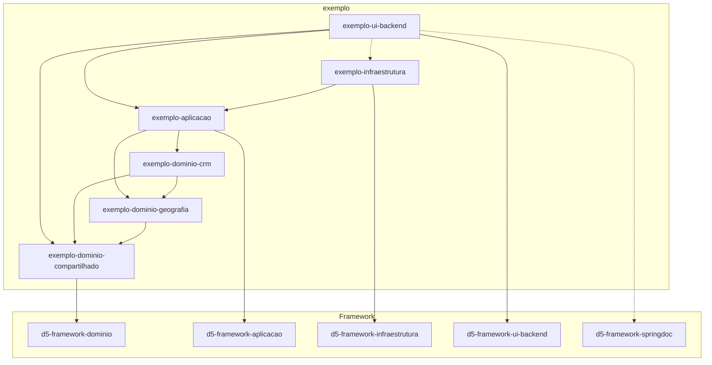
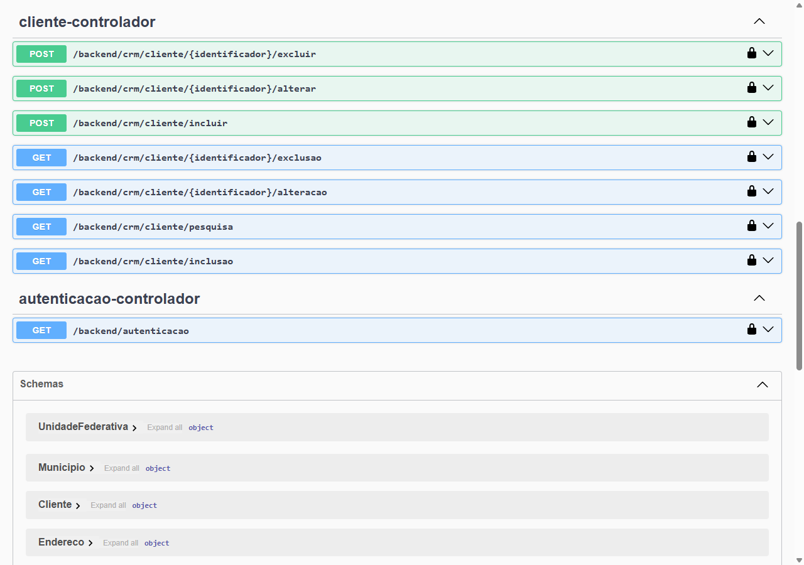
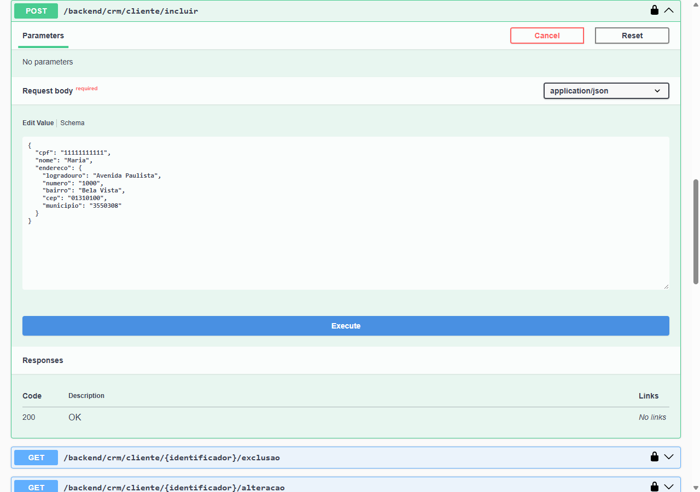
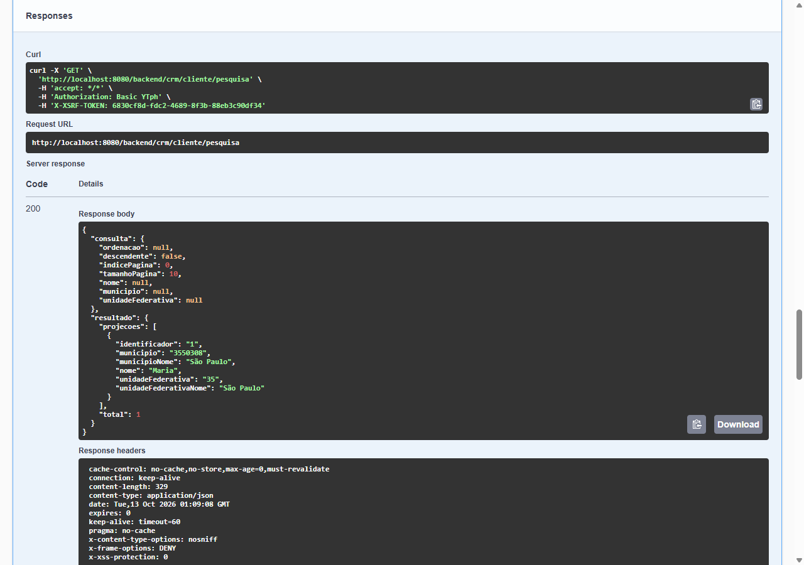
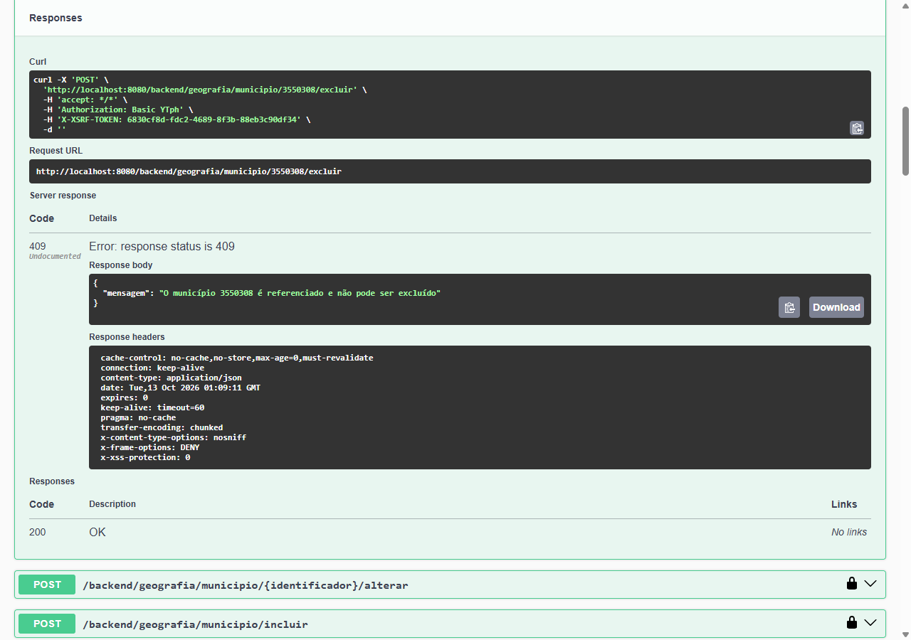

# Lição 3: cliente
Nesta lição, você vai criar o subdomínio CRM e seu agregado cliente, que referencia o município criado na [lição 2](2-municipio.md). Ao final, o projeto corresponde ao diretório `exemplo` do repositório de D5.

Como na lição 2, esta lição explica apenas o que muda em relação às anteriores:

- um novo módulo de subdomínio, que depende de outro subdomínio;
- um identificador artificial, gerado pelo banco de dados na inclusão;
- um objeto de valor formado por vários atributos, o endereço;
- uma regra que depende do estado de outro agregado: o cliente não pode ser vinculado a um município extinto;
- uma projeção que traz dados de dois outros agregados;
- o município passa a ser referenciado e, por isso, não pode mais ser excluído enquanto houver clientes nele.

## Projeto Maven
O subdomínio CRM corresponde ao módulo `exemplo-dominio-crm`. Crie os diretórios do módulo executando os comandos:

=== "Bash"

    ```bash
    mkdir -p exemplo/dominio-crm/src/{main,test}/{java,resources}
    ```

=== "PowerShell"

    ```powershell
    foreach ($d in 'main/java','main/resources','test/java','test/resources') {
        mkdir "exemplo/dominio-crm/src/$d" -Force > $null
    }
    ```

Acrescente o módulo ao `pom.xml` do projeto raiz:

```xml title="exemplo/pom.xml"
--8<-- "exemplo/pom.xml"
```

O cliente referencia o município e, para validar essa referência, seu serviço usa o repositório de município. Por isso, além do domínio compartilhado, o módulo `exemplo-dominio-crm` depende de `exemplo-dominio-geografia`:

```xml title="exemplo/dominio-crm/pom.xml"
--8<-- "exemplo/dominio-crm/pom.xml"
```

Um módulo de subdomínio pode depender de outro, desde que as dependências entre eles não formem um ciclo — por isso Geografia nunca dependerá do CRM. Já o código IBGE do município não vai para o domínio compartilhado, ainda que passe a ser usado pelos dois subdomínios: ele pertence a Geografia, e o compartilhado só contém conceitos sem um subdomínio dono; veja [Dependências entre módulos de domínio](../referencia/convencoes.md#dependencias-entre-modulos-de-dominio).

O módulo de aplicação, que vai conter o serviço de aplicação do cliente, passa a depender também de `exemplo-dominio-crm`:

```xml title="exemplo/aplicacao/pom.xml"
--8<-- "exemplo/aplicacao/pom.xml"
```

Com essas mudanças, as dependências entre os módulos passam a ser:



A infraestrutura e o backend não mudam: o novo módulo de subdomínio chega a eles transitivamente pelo módulo de aplicação.

## Cliente
Um cliente possui CPF único, nome e endereço. Diferente da unidade federativa e do município, cujo identificador é um código definido pelo IBGE, o identificador do cliente é artificial: ele é gerado pelo banco de dados quando o cliente é incluído. Seguindo as [convenções](../referencia/convencoes.md#pacotes), o pacote do agregado é `com.example.exemplo.dominio.crm.cliente`. Crie o `package-info.java` desse pacote, anotado com [`@NullMarked`](../referencia/programacao.md#evite-null):

```java title="exemplo/dominio-crm/src/main/java/com/example/exemplo/dominio/crm/cliente/package-info.java"
--8<-- "exemplo/dominio-crm/src/main/java/com/example/exemplo/dominio/crm/cliente/package-info.java"
```

### Domínio

#### Identificador
O identificador do cliente não tem formato definido pelo domínio — é um número gerado pelo banco de dados, que o domínio trata apenas como texto. Por isso, ele herda de [`ObjetoValorStringAbstrato`](../referencia/framework/dominio.md#objetovalorstringabstrato), e não de `ObjetoValorRegexAbstrato`, exigindo apenas que não esteja em branco.

```java title="exemplo/dominio-crm/src/main/java/com/example/exemplo/dominio/crm/cliente/ClienteIdentificador.java"
--8<-- "exemplo/dominio-crm/src/main/java/com/example/exemplo/dominio/crm/cliente/ClienteIdentificador.java"
```

#### CPF e CEP
O CPF e o CEP são formados por onze e oito dígitos, respectivamente, e, como a sigla e o código IBGE, herdam de [`ObjetoValorRegexAbstrato`](../referencia/framework/dominio.md#objetovalorregexabstrato). Seguindo as [convenções](../referencia/convencoes.md#nomenclatura), o nome de cada um combina o conceito ao qual pertence — o cliente e o endereço — com o atributo.

```java title="exemplo/dominio-crm/src/main/java/com/example/exemplo/dominio/crm/cliente/ClienteCpf.java"
--8<-- "exemplo/dominio-crm/src/main/java/com/example/exemplo/dominio/crm/cliente/ClienteCpf.java"
```

```java title="exemplo/dominio-crm/src/main/java/com/example/exemplo/dominio/crm/cliente/EnderecoCep.java"
--8<-- "exemplo/dominio-crm/src/main/java/com/example/exemplo/dominio/crm/cliente/EnderecoCep.java"
```

#### Endereço
O endereço é um [objeto de valor](../referencia/ddd.md#objeto-de-valor) formado por vários atributos — logradouro, número, complemento opcional, bairro, CEP e município —, por isso implementa [`IObjetoValor`](../referencia/framework/dominio.md#iobjetovalor) diretamente e redefine `equals` e `hashCode` a partir de todos eles. Assim como o município referencia a unidade federativa apenas pelo identificador, o endereço referencia o município apenas pelo seu [código IBGE](2-municipio.md#codigo-ibge).

```java title="exemplo/dominio-crm/src/main/java/com/example/exemplo/dominio/crm/cliente/Endereco.java"
--8<-- "exemplo/dominio-crm/src/main/java/com/example/exemplo/dominio/crm/cliente/Endereco.java"
```

#### Agregado
Como o identificador só existe depois que o cliente é incluído, o construtor o recebe envolto em um `Optional`: vazio na inclusão e presente nas demais operações.

```java title="exemplo/dominio-crm/src/main/java/com/example/exemplo/dominio/crm/cliente/Cliente.java"
--8<-- "exemplo/dominio-crm/src/main/java/com/example/exemplo/dominio/crm/cliente/Cliente.java"
```

#### Repositório
O repositório expõe `existePorCpf`, que, como `existePorSigla` na unidade federativa, ignora o identificador do próprio cliente na verificação. Crie o pacote `spi` e seu `package-info.java`, anotado com [`@NullMarked`](../referencia/programacao.md#evite-null):

```java title="exemplo/dominio-crm/src/main/java/com/example/exemplo/dominio/crm/cliente/spi/package-info.java"
--8<-- "exemplo/dominio-crm/src/main/java/com/example/exemplo/dominio/crm/cliente/spi/package-info.java"
```

```java title="exemplo/dominio-crm/src/main/java/com/example/exemplo/dominio/crm/cliente/spi/IClienteRepositorio.java"
--8<-- "exemplo/dominio-crm/src/main/java/com/example/exemplo/dominio/crm/cliente/spi/IClienteRepositorio.java"
```

#### Serviço
O serviço recebe, além do repositório de cliente, o [repositório de município](2-municipio.md#repositorio), do subdomínio Geografia. Em `validarInclusaoAlteracao`, ele exige que o CPF seja único e, [validando o estado](../referencia/programacao.md#validacao-de-estado) da aplicação, que o município do endereço não esteja extinto, reutilizando o modelo de mensagem de [`Municipio`](2-municipio.md#agregado). Para isso, busca o município com `buscarPorIdentificador`, que já lança [`AgregadoInexistenteExcecao`](../referencia/framework/dominio.md#agregadoinexistenteexcecao) quando ele não existe — dispensando uma verificação de existência à parte. Como a regra vale também para a alteração, um cliente de um município extinto só pode ser alterado se o seu endereço passar a apontar para outro município.

Na inclusão, `AgregadoServicoAbstrato` só verifica a inexistência do identificador quando ele está presente; como o identificador do cliente é gerado pelo banco de dados, essa verificação não ocorre.

```java title="exemplo/dominio-crm/src/main/java/com/example/exemplo/dominio/crm/cliente/ClienteServico.java"
--8<-- "exemplo/dominio-crm/src/main/java/com/example/exemplo/dominio/crm/cliente/ClienteServico.java"
```

#### Testes
Como todo módulo de subdomínio, `exemplo-dominio-crm` tem a sua suíte do Cucumber:

```java title="exemplo/dominio-crm/src/test/java/com/example/exemplo/dominio/crm/CucumberTests.java"
--8<-- "exemplo/dominio-crm/src/test/java/com/example/exemplo/dominio/crm/CucumberTests.java"
```

Escreva os cenários cobrindo inclusão, busca, alteração e exclusão de um cliente, incluindo as regras de autorização, de unicidade do CPF e de existência e extinção do município:

```gherkin title="exemplo/dominio-crm/src/test/resources/features/cliente.feature"
--8<-- "exemplo/dominio-crm/src/test/resources/features/cliente.feature"
```

As step definitions dublam também o repositório de município, que simula os municípios através de um mapa em memória. Como o identificador é gerado pelo banco de dados, o repositório de cliente simulado gera identificadores sequenciais na inclusão.

```java title="exemplo/dominio-crm/src/test/java/com/example/exemplo/dominio/crm/cliente/ClienteStepDefinitions.java"
--8<-- "exemplo/dominio-crm/src/test/java/com/example/exemplo/dominio/crm/cliente/ClienteStepDefinitions.java"
```

### Município referenciado
Agora que clientes referenciam municípios, o município passa por mudança análoga à que a unidade federativa sofreu na [lição 2](2-municipio.md#unidade-federativa-referenciada). Acrescente `existeReferencia` ao repositório de município:

```java title="exemplo/dominio-geografia/src/main/java/com/example/exemplo/dominio/geografia/municipio/spi/IMunicipioRepositorio.java"
--8<-- "exemplo/dominio-geografia/src/main/java/com/example/exemplo/dominio/geografia/municipio/spi/IMunicipioRepositorio.java"
```

Em `MunicipioServico`, sobrescreva `validarExclusao` para impedir a exclusão de um município referenciado:

```java title="exemplo/dominio-geografia/src/main/java/com/example/exemplo/dominio/geografia/municipio/MunicipioServico.java"
--8<-- "exemplo/dominio-geografia/src/main/java/com/example/exemplo/dominio/geografia/municipio/MunicipioServico.java"
```

Note que o subdomínio Geografia continua sem depender do subdomínio CRM: o serviço de município não sabe que são clientes que o referenciam. Acrescente aos cenários do município a exclusão de um município referenciado e, às step definitions, a simulação dos municípios referenciados:

```gherkin title="exemplo/dominio-geografia/src/test/resources/features/municipio.feature"
--8<-- "exemplo/dominio-geografia/src/test/resources/features/municipio.feature"
```

```java title="exemplo/dominio-geografia/src/test/java/com/example/exemplo/dominio/geografia/municipio/MunicipioStepDefinitions.java"
--8<-- "exemplo/dominio-geografia/src/test/java/com/example/exemplo/dominio/geografia/municipio/MunicipioStepDefinitions.java"
```

### Aplicação
As classes de aplicação do cliente ficam no pacote `com.example.exemplo.aplicacao.crm.cliente`. Crie o `package-info.java` desse pacote, anotado com [`@NullMarked`](../referencia/programacao.md#evite-null):

```java title="exemplo/aplicacao/src/main/java/com/example/exemplo/aplicacao/crm/cliente/package-info.java"
--8<-- "exemplo/aplicacao/src/main/java/com/example/exemplo/aplicacao/crm/cliente/package-info.java"
```

#### Projeção
A projeção traz, além do identificador e do nome do cliente, o código e o nome do município e o código e o nome da unidade federativa do endereço. O construtor usado pela consulta JPQL recebe o identificador como `Long`, o tipo usado pela entidade JPA.

```java title="exemplo/aplicacao/src/main/java/com/example/exemplo/aplicacao/crm/cliente/ClienteProjecao.java"
--8<-- "exemplo/aplicacao/src/main/java/com/example/exemplo/aplicacao/crm/cliente/ClienteProjecao.java"
```

#### Ordenação
Os clientes podem ser ordenados pelo identificador, pelo nome, pelo nome do município e pelo nome da unidade federativa.

```java title="exemplo/aplicacao/src/main/java/com/example/exemplo/aplicacao/crm/cliente/ClienteOrdenacao.java"
--8<-- "exemplo/aplicacao/src/main/java/com/example/exemplo/aplicacao/crm/cliente/ClienteOrdenacao.java"
```

#### Consulta
A consulta filtra os clientes por um trecho do nome, pelo código do município e pelo código da unidade federativa.

```java title="exemplo/aplicacao/src/main/java/com/example/exemplo/aplicacao/crm/cliente/ClienteConsulta.java"
--8<-- "exemplo/aplicacao/src/main/java/com/example/exemplo/aplicacao/crm/cliente/ClienteConsulta.java"
```

#### Repositório de aplicação e serviço de aplicação
Crie a interface do repositório de aplicação no pacote `spi` e o serviço de aplicação, como nas lições anteriores:

```java title="exemplo/aplicacao/src/main/java/com/example/exemplo/aplicacao/crm/cliente/spi/package-info.java"
--8<-- "exemplo/aplicacao/src/main/java/com/example/exemplo/aplicacao/crm/cliente/spi/package-info.java"
```

```java title="exemplo/aplicacao/src/main/java/com/example/exemplo/aplicacao/crm/cliente/spi/IClienteAplicacaoRepositorio.java"
--8<-- "exemplo/aplicacao/src/main/java/com/example/exemplo/aplicacao/crm/cliente/spi/IClienteAplicacaoRepositorio.java"
```

```java title="exemplo/aplicacao/src/main/java/com/example/exemplo/aplicacao/crm/cliente/ClienteAplicacaoServico.java"
--8<-- "exemplo/aplicacao/src/main/java/com/example/exemplo/aplicacao/crm/cliente/ClienteAplicacaoServico.java"
```

### Infraestrutura
A persistência de cliente fica no pacote `com.example.exemplo.infraestrutura.crm.cliente`. Crie o `package-info.java` desse pacote, anotado com [`@NullMarked`](../referencia/programacao.md#evite-null):

```java title="exemplo/infraestrutura/src/main/java/com/example/exemplo/infraestrutura/crm/cliente/package-info.java"
--8<-- "exemplo/infraestrutura/src/main/java/com/example/exemplo/infraestrutura/crm/cliente/package-info.java"
```

#### Entidade JPA
O identificador é um `Long` gerado pelo banco de dados — por isso é anotado com `@GeneratedValue` e admite `null` antes da inclusão. Os atributos do endereço são mapeados para colunas da própria tabela de clientes, e o município, como na entidade JPA do município, é guardado apenas pelo seu código. O complemento, opcional, é a única coluna sem `@NotNull`. A coluna do CPF é única, garantindo no banco de dados a mesma unicidade validada pelo serviço.

```java title="exemplo/infraestrutura/src/main/java/com/example/exemplo/infraestrutura/crm/cliente/ClienteJpa.java"
--8<-- "exemplo/infraestrutura/src/main/java/com/example/exemplo/infraestrutura/crm/cliente/ClienteJpa.java"
```

#### Repositório Spring Data
`existePorCpf` segue o padrão das verificações de unicidade das lições anteriores. A consulta de `pesquisar` faz duas junções explícitas: com o município do endereço e, a partir dele, com a unidade federativa.

```java title="exemplo/infraestrutura/src/main/java/com/example/exemplo/infraestrutura/crm/cliente/IClienteRepositorioJpa.java"
--8<-- "exemplo/infraestrutura/src/main/java/com/example/exemplo/infraestrutura/crm/cliente/IClienteRepositorioJpa.java"
```

#### Implementação do repositório
`paraIdentificadorJpa` converte o identificador do domínio para o `Long` da entidade JPA, e `paraAgregado` faz a conversão inversa — exigindo, com `Objects.requireNonNull`, que a entidade lida do banco de dados tenha identificador. `paraJpa` e `paraAgregado` também convertem o endereço de e para as colunas da entidade JPA.

```java title="exemplo/infraestrutura/src/main/java/com/example/exemplo/infraestrutura/crm/cliente/ClienteRepositorio.java"
--8<-- "exemplo/infraestrutura/src/main/java/com/example/exemplo/infraestrutura/crm/cliente/ClienteRepositorio.java"
```

#### Implementação do repositório de aplicação
As ordenações pelo nome do município e pelo nome da unidade federativa são mapeadas para `m.nome` e `u.nome`, os aliases das junções declaradas na consulta de `pesquisar`.

```java title="exemplo/infraestrutura/src/main/java/com/example/exemplo/infraestrutura/crm/cliente/ClienteAplicacaoRepositorio.java"
--8<-- "exemplo/infraestrutura/src/main/java/com/example/exemplo/infraestrutura/crm/cliente/ClienteAplicacaoRepositorio.java"
```

#### Município referenciado
Implemente `existeReferencia` no repositório de município, com uma consulta que verifica se algum cliente referencia o município:

```java title="exemplo/infraestrutura/src/main/java/com/example/exemplo/infraestrutura/geografia/municipio/IMunicipioRepositorioJpa.java"
--8<-- "exemplo/infraestrutura/src/main/java/com/example/exemplo/infraestrutura/geografia/municipio/IMunicipioRepositorioJpa.java"
```

```java title="exemplo/infraestrutura/src/main/java/com/example/exemplo/infraestrutura/geografia/municipio/MunicipioRepositorio.java"
--8<-- "exemplo/infraestrutura/src/main/java/com/example/exemplo/infraestrutura/geografia/municipio/MunicipioRepositorio.java"
```

É no módulo de infraestrutura, que conhece as entidades JPA de todos os subdomínios, que a referência do CRM ao subdomínio Geografia é verificada.

#### Testes do repositório
Escreva os testes do repositório de cliente, cobrindo as operações do repositório — inclusive a geração do identificador na inclusão e um cliente sem complemento — e as variações de `existePorCpf`:

```java title="exemplo/infraestrutura/src/test/java/com/example/exemplo/infraestrutura/crm/cliente/ClienteRepositorioTest.java"
--8<-- "exemplo/infraestrutura/src/test/java/com/example/exemplo/infraestrutura/crm/cliente/ClienteRepositorioTest.java"
```

Como as junções da pesquisa são internas, os testes do repositório de aplicação persistem as unidades federativas e os municípios antes dos clientes. Além dos filtros, eles cobrem as ordenações pelo nome do município e da unidade federativa.

```java title="exemplo/infraestrutura/src/test/java/com/example/exemplo/infraestrutura/crm/cliente/ClienteAplicacaoRepositorioTest.java"
--8<-- "exemplo/infraestrutura/src/test/java/com/example/exemplo/infraestrutura/crm/cliente/ClienteAplicacaoRepositorioTest.java"
```

Acrescente aos testes do repositório de município a verificação de `existeReferencia`, persistindo um cliente diretamente através de `IClienteRepositorioJpa`:

```java title="exemplo/infraestrutura/src/test/java/com/example/exemplo/infraestrutura/geografia/municipio/MunicipioRepositorioTest.java"
--8<-- "exemplo/infraestrutura/src/test/java/com/example/exemplo/infraestrutura/geografia/municipio/MunicipioRepositorioTest.java"
```

### UI
O cliente é exposto no pacote `com.example.exemplo.ui.backend.crm.cliente`, com o caminho `crm/cliente`. Crie o `package-info.java` desse pacote, anotado com [`@NullMarked`](../referencia/programacao.md#evite-null), e o controlador, como o da [unidade federativa](1-unidade-federativa.md#controlador):

```java title="exemplo/ui-backend/src/main/java/com/example/exemplo/ui/backend/crm/cliente/package-info.java"
--8<-- "exemplo/ui-backend/src/main/java/com/example/exemplo/ui/backend/crm/cliente/package-info.java"
```

```java title="exemplo/ui-backend/src/main/java/com/example/exemplo/ui/backend/crm/cliente/ClienteControlador.java"
--8<-- "exemplo/ui-backend/src/main/java/com/example/exemplo/ui/backend/crm/cliente/ClienteControlador.java"
```

#### Testando com o Swagger UI
Suba novamente `BackendAplicacao`, acesse o Swagger UI e autentique-se como na [lição 1](1-unidade-federativa.md#testando-com-o-swagger-ui). As operações de cliente aparecem sob a tag `cliente-controlador`:



Inclua a unidade federativa e o município de São Paulo, como nas lições anteriores, e, em seguida, inclua um cliente através de `POST /backend/crm/cliente/incluir`. O identificador é omitido, porque é gerado na inclusão, e o complemento do endereço é opcional:

```json
{
  "cpf": "11111111111",
  "nome": "Maria",
  "endereco": {
    "logradouro": "Avenida Paulista",
    "numero": "1000",
    "bairro": "Bela Vista",
    "cep": "01310100",
    "municipio": "3550308"
  }
}
```



`GET /backend/crm/cliente/pesquisa` devolve, para cada cliente, o identificador gerado na inclusão e os nomes do município e da unidade federativa:



Tente, então, excluir o município de São Paulo: como ele é referenciado pelo cliente, a exclusão responde 409, com a mensagem `O município 3550308 é referenciado e não pode ser excluído`. Do mesmo modo, incluir um cliente em um município extinto responde 409, com a mensagem `O município ... está extinto`.


